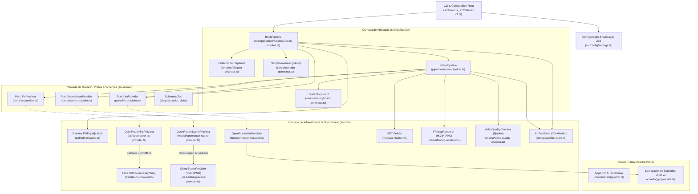
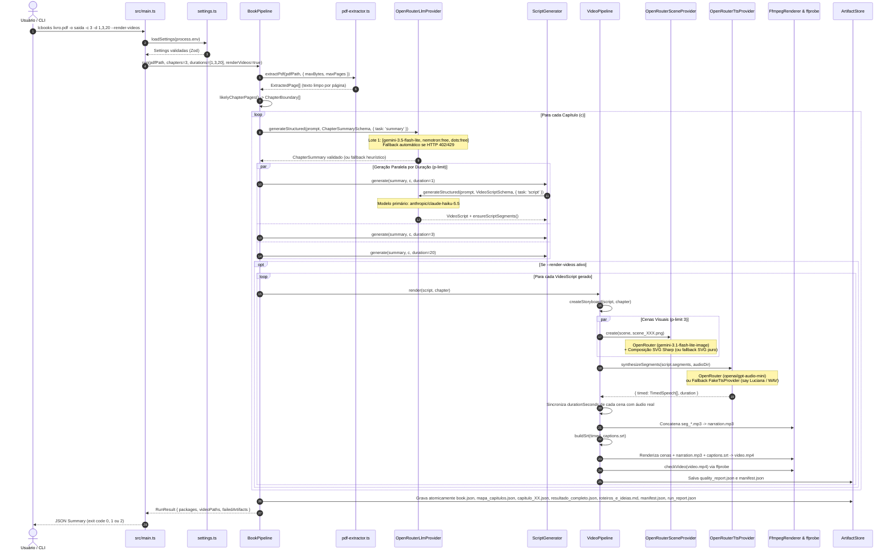
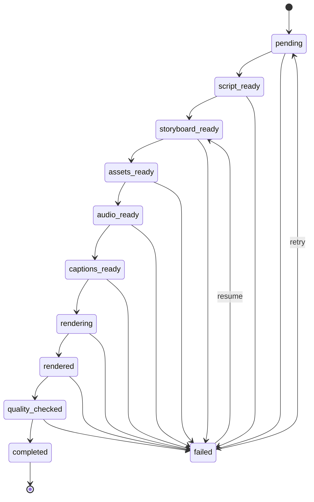

# DocToCine (lcBooks Pipeline)

Pipeline multimodal em **TypeScript 5.9 / Node.js 24 LTS** para conversão automatizada de documentos e livros em formato PDF em pacotes editoriais estruturados, roteiros de múltiplas durações (`1`, `3` e `20` minutos) e vídeos cinematográficos (`MP4` H.264/AAC), integrando o ecossistema **OpenRouter (`https://openrouter.ai/api/v1`)** com seleção de modelo especializado por atividade, geração de ilustrações de cenas por IA composta via **Sharp (SVG/PNG)**, síntese neural de voz (TTS) com alinhamento temporal por segmento, legendagem sincronizada (**SRT**) e auditoria automatizada de qualidade (**FFmpeg / FFprobe**).

O projeto adota **Clean Architecture** e **Arquitetura Hexagonal (Ports & Adapters)**, mantendo o núcleo de domínio e os casos de uso 100% desacoplados dos adaptadores de infraestrutura (OpenRouter HTTP/JSON/Image/Audio, PDF.js, Sharp, FFmpeg e persistência atômica em disco).

---

## Sumário

- [1. Visão Geral da Arquitetura](#1-visão-geral-da-arquitetura)
- [2. Roteamento Multimodal por Atividade no OpenRouter](#2-roteamento-multimodal-por-atividade-no-openrouter)
  - [2.1 Matriz de Modelos por Tarefa e Cadeias de Failover](#21-matriz-de-modelos-por-tarefa-e-cadeias-de-failover)
  - [2.2 Algoritmo de Multi-Batch Failover e Resiliência HTTP](#22-algoritmo-de-multi-batch-failover-e-resiliência-http)
- [3. Estrutura Completa do Repositório](#3-estrutura-completa-do-repositório)
- [4. Detalhamento Aprofundado de Cada Código (Arquivo por Arquivo)](#4-detalhamento-aprofundado-de-cada-código-arquivo-por-arquivo)
  - [4.1 Ponto de Entrada e CLI (`src/main.ts`, `src/cli/build-cli.ts`)](#41-ponto-de-entrada-e-cli-srcmaints-srcclibuild-clits)
  - [4.2 Configuração, Erros e Segurança (`src/config/`, `src/core/`)](#42-configuração-erros-e-segurança-srcconfig-srccore)
  - [4.3 Camada de Domínio: Portas e Schemas (`src/domain/`)](#43-camada-de-domínio-portas-e-schemas-srcdomain)
  - [4.4 Camada de Aplicação: Serviços e Pipelines (`src/application/`)](#44-camada-de-aplicação-serviços-e-pipelines-srcapplication)
  - [4.5 Camada de Infraestrutura e Adaptadores (`src/infra/`)](#45-camada-de-infraestrutura-e-adaptadores-srcinfra)
  - [4.6 Suítes de Testes Automatizados (`tests/unit/`)](#46-suítes-de-testes-automatizados-testsunit)
  - [4.7 Configurações do Ecossistema e CI/CD](#47-configurações-do-ecossistema-e-cicd)
- [5. Fluxo de Execução Ponta a Ponta (End-to-End Lifecycle)](#5-fluxo-de-execução-ponta-a-ponta-end-to-end-lifecycle)
  - [5.1 Diagrama de Sequência Completo](#51-diagrama-de-sequência-completo)
  - [5.2 Passo a Passo Técnico da Execução](#52-passo-a-passo-técnico-da-execução)
  - [5.3 Máquina de Estados Finitos do Vídeo](#53-máquina-de-estados-finitos-do-vídeo)
- [6. Estrutura de Artefatos Gerados e Contratos JSON](#6-estrutura-de-artefatos-gerados-e-contratos-json)
- [7. Instalação, Configuração e Execução](#7-instalação-configuração-e-execução)
- [8. Engenharia de Segurança, Desempenho e Boas Práticas](#8-engenharia-de-segurança-desempenho-e-boas-práticas)

---

## 1. Visão Geral da Arquitetura

O sistema é dividido em 4 anéis concêntricos estritamente tipados e validados em tempo de execução com **Zod 4**:

1. **Domínio (`src/domain/`)**: Contratos imutáveis, schemas de validação, normalizadores de dados e portas de abstração (`LlmProvider`, `TtsProvider`, `SceneAssetProvider`). Não depende de nenhuma biblioteca externa além do `zod`.
2. **Aplicação (`src/application/`)**: Casos de uso e orquestradores (`BookPipeline`, `VideoPipeline`, `ScriptGenerator`, `chapter-detector`, `storyboard-generator`). Coordena o fluxo de trabalho através das portas do domínio e controla paralelismo com `p-limit`.
3. **Infraestrutura (`src/infra/`)**: Implementações concretas das portas para o ecossistema **OpenRouter** (`OpenRouterLlmProvider`, `OpenRouterTtsProvider`, `OpenRouterSceneProvider`), motores locais de contingência (`FakeTtsProvider`, `SharpSceneProvider`), extração PDF (`pdfjs-dist`), legendagem (`srt-builder`), renderização (`FfmpegRenderer`), auditoria (`video-quality-checker`) e persistência transacional (`ArtifactStore`).
4. **Configuração, Core & CLI (`src/main.ts`, `src/cli/`, `src/config/`, `src/core/`)**: Composição de dependências (Dependency Injection Root), parsing de argumentos CLI via `commander`, validação de ambiente e sanitização contra vazamento de segredos.



---

## 2. Roteamento Multimodal por Atividade no OpenRouter

Em vez de utilizar um único modelo monolítico para tarefas com exigências cognitivas e multimodais distintas, o DocToCine implementa roteamento especializado por tarefa através da porta [`LlmProvider`](file:///Users/rafaelaparecido/Documents/DocToCine/src/domain/ports/llm-provider.ts), [`TtsProvider`](file:///Users/rafaelaparecido/Documents/DocToCine/src/domain/ports/tts-provider.ts) e [`SceneAssetProvider`](file:///Users/rafaelaparecido/Documents/DocToCine/src/domain/ports/scene-provider.ts).

### 2.1 Matriz de Modelos por Tarefa e Cadeias de Failover

| Atividade / Função                                                | Porta / Serviço                                  | Variável de Ambiente          | Modelo Primário (OpenRouter)         | Cadeia de Fallback Automático (Free Tier / Local)                                                                                                                  | Por que este modelo foi selecionado                                                                                                                                                                                                                |
| :---------------------------------------------------------------- | :----------------------------------------------- | :---------------------------- | :----------------------------------- | :----------------------------------------------------------------------------------------------------------------------------------------------------------------- | :------------------------------------------------------------------------------------------------------------------------------------------------------------------------------------------------------------------------------------------------- |
| **1. Análise Literária e Resumo de Capítulos (`summary`)**        | `LlmProvider` (`task: 'summary'`)                | `OPENROUTER_SUMMARY_MODEL`    | `google/gemini-3.5-flash-lite`       | `nvidia/nemotron-3-super-120b-a12b:free` ➔ `dots-studio/dots-3-note-preview:free` ➔ `liquid/lfm-2.5-2.6b:free` ➔ `openrouter/free` ➔ Extração determinística local | Ampla janela de contexto para processar páginas extraídas do PDF (`MAX_CHAPTER_CHARS_PER_CHUNK`), baixa latência, temperatura reduzida (`0.2`) para fidelidade factual e suporte nativo a JSON estruturado.                                        |
| **2. Roteirização Cinematográfica 1, 3 e 20 min (`script`)**      | `LlmProvider` (`task: 'script'`)                 | `OPENROUTER_SCRIPT_MODEL`     | `anthropic/claude-haiku-5.5`         | `nvidia/nemotron-3-super-120b-a12b:free` ➔ `dots-studio/dots-3-note-preview:free` ➔ `liquid/lfm-2.5-2.6b:free` ➔ `openrouter/free` ➔ `generateDeterministic`       | Escrita criativa superior em Português (`pt-BR`), ritmo dramático de audiolivro, temperatura calibrada (`0.6`) e cumprimento rigoroso de metas de parágrafos e contagem de palavras.                                                               |
| **3. Direção de Storyboard (`storyboard`)**                       | `LlmProvider` (`task: 'storyboard'`)             | `OPENROUTER_STORYBOARD_MODEL` | `google/gemini-3.5-flash-lite`       | Cadeia `OPENROUTER_FALLBACK_MODELS`                                                                                                                                | Estruturação rápida de metadados visuais e decupagem técnica de cenas.                                                                                                                                                                             |
| **4. Geração de Ilustrações de Cenas para Vídeo (`scene_image`)** | `SceneAssetProvider` (`OpenRouterSceneProvider`) | `OPENROUTER_IMAGE_MODEL`      | `google/gemini-3.1-flash-lite-image` | `openai/gpt-5-image-mini` ➔ Fallback vetorial local em `SharpSceneProvider` (SVG/PNG gradiente)                                                                    | Usa a modalidade nativa `modalities: ['image', 'text']` do OpenRouter (Nano Banana 2 Lite) com `image_config.aspect_ratio` (`16:9` ou `9:16`), compondo a arte gerada por IA com tipografia vetorial e barra de progresso no `SharpSceneProvider`. |
| **5. Síntese Neural de Voz / Narração (`audio`)**                 | `TtsProvider` (`OpenRouterTtsProvider`)          | `OPENROUTER_AUDIO_MODEL`      | `openai/gpt-audio-mini`              | `openai/gpt-audio` ➔ Fallback local em `FakeTtsProvider` (`say -v Luciana` macOS + `ffmpeg` MP3 ou WAV harmônico PCM)                                              | Usa a modalidade nativa `modalities: ['text', 'audio']` com `audio: { voice: 'nova', format: 'mp3' }` para narração expressiva em português, medindo a duração exata com `ffprobe`.                                                                |

### 2.2 Algoritmo de Multi-Batch Failover e Resiliência HTTP

A API do OpenRouter (`POST /api/v1/chat/completions`) impõe a restrição estrita de **no máximo 3 modelos** no array `models` por requisição HTTP (`'models' array must have 3 items or fewer`). Para superar esse limite e permitir cadeias longas de contingência (combinando modelos pagos de ponta e múltiplos modelos `:free`), o [`OpenRouterLlmProvider`](file:///Users/rafaelaparecido/Documents/DocToCine/src/infra/llm/openrouter-provider.ts) implementa:

1. **Particionamento em Lotes (`buildModelBatches`)**: Remove duplicatas da lista `[primaryModel, ...fallbackModels]` e fatia os candidatos em sub-arrays de até 3 modelos cada.
2. **Failover Híbrido (Server-Side + Client-Side)**:
   - Dentro de cada lote de até 3 modelos, o próprio roteador do OpenRouter realiza failover instantâneo no servidor.
   - Se o lote retornar `HTTP 402` (saldo insuficiente para modelos pagos na conta), o cliente avança **imediatamente** (`break`) para o próximo lote (composto pelos modelos `:free`), sem desperdiçar tempo em retentativas no mesmo lote.
   - Se o lote retornar status transiente (`408`, `429`, `500`, `502`, `503`, `504`), aplica **Exponential Backoff com Jitter** (`Math.min(2000, 150 * 2^attempt) + random(0..50)ms`) até `maxRetries` antes de tentar o próximo lote.
   - Se retornar `401` ou `403` (credencial inválida), aborta imediatamente lançando `AppError` com `code: 'LLM_AUTH'` e `retryable: false`.
3. **Higienização e Extração Defensiva de JSON (`extractJsonPayload`)**:
   - Modelos de raciocínio e modelos `:free` frequentemente envolvem a resposta em tags `<think>...</think>`, blocos Markdown ` ```json ... ``` ` ou comentários introdutórios.
   - A função `extractJsonPayload(raw)` remove blocos `<think>`, tenta `JSON.parse` direto, extrai blocos cercados por crases e, em último caso, localiza o primeiro `{` e o último `}` balanceados antes de entregar o objeto ao parser estrito do Zod (`schema.parse(json)`).

---

## 3. Estrutura Completa do Repositório

```text
DocToCine/
├── .github/
│   └── workflows/
│       └── ci.yml                           # Pipeline de Integração Contínua (GitHub Actions - Node 24)
├── src/
│   ├── main.ts                              # Ponto de entrada executável da CLI lcbooks e injeção de dependências
│   ├── cli/
│   │   └── build-cli.ts                     # Definição declarativa de argumentos e flags via Commander
│   ├── config/
│   │   └── settings.ts                      # Validação Zod de variáveis de ambiente e modelos OpenRouter
│   ├── core/
│   │   ├── errors/
│   │   │   └── app-error.ts                 # Classe AppError, ErrorStage, ErrorCode e helper asError
│   │   └── logging/
│   │       └── redact.ts                    # Sanitização de chaves (sk-or-v1-*, sk-*, AIza*, ya29*)
│   ├── domain/
│   │   ├── ports/
│   │   │   ├── llm-provider.ts              # Porta LlmProvider com roteamento por LlmTaskType
│   │   │   ├── tts-provider.ts              # Porta TtsProvider e contrato TimedSpeech
│   │   │   └── scene-provider.ts            # Porta SceneAssetProvider para geração de imagens de cenas
│   │   └── schemas/
│   │       ├── chapter.schema.ts            # Schemas Zod de limites, mapas, resumos e pacotes de capítulos
│   │       ├── script.schema.ts             # Schemas Zod de roteiros (1, 3, 20m) e segmentação automática
│   │       └── video.schema.ts              # Máquina de estados do vídeo, storyboard, manifesto e quality report
│   ├── application/
│   │   ├── services/
│   │   │   ├── chapter-detector.ts          # Heurísticas regex de detecção e normalização de capítulos
│   │   │   ├── script-generator.ts          # Gerador de roteiros via LLM (task: 'script') + fallback determinístico
│   │   │   └── storyboard-generator.ts      # Conversão de segmentos em cenas visuais com cálculo temporal
│   │   └── pipelines/
│   │       ├── book-pipeline.ts             # Orquestrador mestre: PDF -> Capítulos -> Resumos -> Roteiros -> Vídeos
│   │       └── video-pipeline.ts            # Orquestrador multimídia: Cenas -> TTS -> FFmpeg Concat -> SRT -> MP4 -> QA
│   └── infra/
│       ├── llm/
│       │   └── openrouter-provider.ts       # Adaptador OpenRouterLlmProvider, buildModelBatches e extractJsonPayload
│       ├── pdf/
│       │   └── pdf-extractor.ts             # Extração de texto PDF via pdfjs-dist com limites de segurança
│       ├── storage/
│       │   └── artifact-store.ts            # Persistência atômica (.tmp -> rename), SHA-256 e proteção path traversal
│       ├── tts/
│       │   ├── openrouter-tts-provider.ts   # Síntese neural via OpenRouter (openai/gpt-audio-mini) + ffprobe
│       │   └── fake-tts-provider.ts         # Síntese local (macOS say Luciana -> MP3 + gerador WAV PCM 8kHz)
│       └── media/
│           ├── openrouter-scene-provider.ts # Geração de ilustrações via OpenRouter (gemini-3.1-flash-lite-image)
│           ├── sharp-scene-provider.ts      # Composição de cenas SVG + background IA para PNG via Sharp
│           ├── srt-builder.ts               # Construção proporcional e parser verificador de legendas SubRip (.srt)
│           ├── ffmpeg-renderer.ts           # Renderizador seguro (shell: false) de vídeo H.264/AAC com burn-in SRT
│           └── video-quality-checker.ts     # Auditoria técnica de streams, resolução e codecs via ffprobe
├── tests/
│   └── unit/
│       ├── domain.test.ts                   # Testes unitários de schemas, máquina de estados, redact e settings
│       └── openrouter.test.ts               # Testes unitários do OpenRouter (LLM, batches, 402 fallback, TTS e Scene)
├── .env.example                             # Template seguro de variáveis de ambiente (sem chaves reais)
├── .gitignore                               # Exclusões do Git (.env, node_modules, dist, saida*, *.tmp)
├── .prettierignore                          # Exclusões de formatação Prettier
├── .prettierrc.json                         # Regras de estilo Prettier
├── eslint.config.js                         # Configuração ESLint 9 Flat Config + typescript-eslint
├── package.json                             # Manifesto NPM, scripts de ciclo de vida e dependências enxutas
├── tsconfig.json                            # Configuração TypeScript estrita para desenvolvimento e typecheck
├── tsconfig.build.json                      # Configuração TypeScript para build de produção em dist/
├── vitest.config.ts                         # Configuração da suíte de testes Vitest e cobertura V8
└── README.md                                # Documentação arquitetural e técnica completa
```

---

## 4. Detalhamento Aprofundado de Cada Código (Arquivo por Arquivo)

### 4.1 Ponto de Entrada e CLI (`src/main.ts`, `src/cli/build-cli.ts`)

#### [`src/main.ts`](file:///Users/rafaelaparecido/Documents/DocToCine/src/main.ts)

- **Responsabilidade:** Ponto de entrada executável (`#!/usr/bin/env node`) e **Composition Root** (Injeção de Dependências).
- **Fluxo Interno da Função `run(argv)`:**
  1. Invoca `buildCli().parse(argv)` para extrair o argumento posicional `<pdf>` e as opções `--output`, `--chapters`, `--durations`, `--render-videos` e `--aspect-ratio`.
  2. Carrega e valida todas as variáveis de ambiente através de `loadSettings()`.
  3. Faz o parsing da flag `--durations` (ex.: `'1,3,20'`), filtrando estritamente os valores permitidos pelo tipo literal `1 | 3 | 20`. Caso nenhuma duração válida seja informada, lança erro imediato.
  4. Calcula a resolução alvo `[width, height]`:
     - Para `16:9` (padrão): `[VIDEO_WIDTH, VIDEO_HEIGHT]` (`1920x1080`).
     - Para `9:16` (vertical/Reels/Shorts/TikTok): inverte automaticamente para `[VIDEO_HEIGHT, VIDEO_WIDTH]` (`1080x1920`).
  5. **Injeção de Provedores Multimodais**:
     - `sceneProvider`: Se `SCENE_PROVIDER === 'openrouter'` e `OPENROUTER_API_KEY` estiver definida, instancia [`OpenRouterSceneProvider`](file:///Users/rafaelaparecido/Documents/DocToCine/src/infra/media/openrouter-scene-provider.ts); caso contrário, instancia [`SharpSceneProvider`](file:///Users/rafaelaparecido/Documents/DocToCine/src/infra/media/sharp-scene-provider.ts).
     - `ttsProvider`: Se `TTS_PROVIDER === 'openrouter'` e `OPENROUTER_API_KEY` estiver definida, instancia [`OpenRouterTtsProvider`](file:///Users/rafaelaparecido/Documents/DocToCine/src/infra/tts/openrouter-tts-provider.ts); caso contrário, instancia [`FakeTtsProvider`](file:///Users/rafaelaparecido/Documents/DocToCine/src/infra/tts/fake-tts-provider.ts).
     - `llm`: Se `OPENROUTER_API_KEY` estiver presente, instancia [`OpenRouterLlmProvider`](file:///Users/rafaelaparecido/Documents/DocToCine/src/infra/llm/openrouter-provider.ts) com os modelos dedicados para `summaryModel`, `scriptModel`, `storyboardModel` e `fallbackModels`.
  6. Executa `BookPipeline.run(...)`, imprime no `stdout` o sumário JSON (`output`, `chapters`, `videos`, `failed`) e retorna códigos de saída POSIX semânticos:
     - `0`: Execução 100% concluída sem falhas.
     - `1`: Erro fatal de configuração, entrada ou leitura de PDF.
     - `2`: Execução concluída parcialmente (`failedArtifacts.length > 0`).

#### [`src/cli/build-cli.ts`](file:///Users/rafaelaparecido/Documents/DocToCine/src/cli/build-cli.ts)

- **Responsabilidade:** Declaração da interface de linha de comando com `commander`.
- **Flags Suportadas:**
  - `<pdf>`: Caminho do arquivo PDF de entrada (obrigatório).
  - `-o, --output <dir>`: Diretório base de saída (padrão: `'saida'`).
  - `-c, --chapters <n>`: Quantidade esperada de capítulos (padrão: `'1'`).
  - `-d, --durations <list>`: Lista separada por vírgulas de durações em minutos (padrão: `'1,3,20'`).
  - `--render-videos`: Ativa a pipeline completa de mídia (imagens, áudio, legendas e renderização MP4).
  - `--resume`, `--force`, `--continue-on-error`, `--aspect-ratio <ratio>` (`16:9` ou `9:16`), `-v, --verbose`.

---

### 4.2 Configuração, Erros e Segurança (`src/config/`, `src/core/`)

#### [`src/config/settings.ts`](file:///Users/rafaelaparecido/Documents/DocToCine/src/config/settings.ts)

- **Responsabilidade:** Carregamento (`dotenv/config`) e validação rigorosa de variáveis de ambiente com `Zod`.
- **Validadores Customizados:**
  - `optionalSecret`: Converte strings vazias ou contendo apenas espaços (`""`, `"   "`) em `undefined` antes de validar `z.string().min(1).optional()`, evitando que chaves em branco no `.env` sejam tratadas como tokens válidos.
  - `secureBaseUrl`: Garante que `OPENROUTER_BASE_URL` seja uma URL válida e utilize obrigatoriamente o protocolo `https:` (permitindo `http://localhost` ou `http://127.0.0.1` exclusivamente para servidores de mock em testes locais), prevenindo envio acidental do token `Bearer` em texto claro pela rede.
  - `fallbackModelsSchema`: Aceita tanto um array de strings quanto uma string delimitada por vírgulas no `.env` e converte em um array higienizado de IDs de modelos do OpenRouter.
- **Funções Exportadas:**
  - `loadSettings(env)`: Retorna o objeto `Settings` tipado ou lança um `Error` listando todos os campos inválidos.
  - `requireOpenRouter(settings)`: Verifica a presença de `OPENROUTER_API_KEY` para fluxos que exigem autenticação obrigatória.
  - `publicSettings(settings)`: Retorna um clone seguro das configurações omitindo `OPENROUTER_API_KEY`.

#### [`src/core/errors/app-error.ts`](file:///Users/rafaelaparecido/Documents/DocToCine/src/core/errors/app-error.ts)

- **Responsabilidade:** Taxonomia estruturada de erros de domínio e infraestrutura.
- **Tipos e Classes:**
  - `ErrorStage`: `'configuration' | 'pdf_extraction' | 'chapter_detection' | 'llm' | 'summary' | 'script_generation' | 'storyboard' | 'assets' | 'audio' | 'captions' | 'rendering' | 'quality_check' | 'storage' | 'general'`.
  - `ErrorCode`: `'INVALID_INPUT' | 'PDF_TOO_LARGE' | 'PDF_INVALID' | 'PDF_PAGE_LIMIT' | 'EMPTY_EXTRACTION' | 'LLM_AUTH' | 'LLM_INVALID_OUTPUT' | 'TTS_FAILED' | 'FFMPEG_MISSING' | 'PROCESS_TIMEOUT' | 'ARTIFACT_INVALID' | 'VIDEO_QUALITY_FAILED' | 'UNEXPECTED'`.
  - `AppError`: Subclasse de `Error` que preserva a cadeia causal (`super(message, { cause })`) e adiciona metadados acionáveis (`code`, `stage`, `retryable`).
  - `asError(v: unknown)`: Normaliza qualquer exceção capturada em bloco `catch` para uma instância garantida de `Error`.

#### [`src/core/logging/redact.ts`](file:///Users/rafaelaparecido/Documents/DocToCine/src/core/logging/redact.ts)

- **Responsabilidade:** Prevenção contra vazamento de credenciais (Secret Redaction) em mensagens de erro, logs e payloads serializados.
- **Expressão Regular `KEY`:**
  - Detecta chaves do OpenRouter (`sk-or-v1-[0-9A-Za-z\-_]{16,}`), chaves genéricas padrão OpenAI/Anthropic (`sk-[0-9A-Za-z\-_]{20,}`), chaves Google (`AIza[0-9A-Za-z\-_]{16,}`) e tokens OAuth2 (`ya29\.[0-9A-Za-z\-_]+`), substituindo-as por `[REDACTED_KEY]`.
- **Funções Exportadas:**
  - `sanitizeMessage(message, secrets, maxLength = 2000)`: Aplica a regex `KEY`, mascara qualquer segredo explícito passado no array `secrets` (com comprimento $\ge 4$) por `[REDACTED]` e trunca mensagens longas adicionando `...[truncated]`.
  - `safeJson(value, secrets)`: Serializa qualquer estrutura em JSON aplicando `sanitizeMessage`.

---

### 4.3 Camada de Domínio: Portas e Schemas (`src/domain/`)

#### [`src/domain/ports/llm-provider.ts`](file:///Users/rafaelaparecido/Documents/DocToCine/src/domain/ports/llm-provider.ts)

- **Responsabilidade:** Porta hexagonal para geração estruturada validada por schema, parametrizada pelo tipo de atividade (`LlmTaskType`).
- **Assinatura:**
  ```typescript
  export type LlmTaskType = 'summary' | 'script' | 'storyboard';
  export type LlmCallOptions = { task?: LlmTaskType; systemPrompt?: string };
  export interface LlmProvider {
    generateStructured<T>(
      prompt: string,
      schema: { parse(value: unknown): T },
      options?: LlmCallOptions,
    ): Promise<T>;
  }
  ```

#### [`src/domain/ports/tts-provider.ts`](file:///Users/rafaelaparecido/Documents/DocToCine/src/domain/ports/tts-provider.ts)

- **Responsabilidade:** Porta hexagonal para provedores de síntese de voz (Text-to-Speech) e cronometragem de segmentos.
- **Contrato:**
  - `synthesize(text, path)`: Gera o arquivo de áudio no caminho indicado e retorna `{ path, duration }` em segundos.
  - `synthesizeSegments(segments, dir)`: Sintetiza uma lista de segmentos mantendo um cursor acumulativo (`startSeconds`, `endSeconds`) e retorna `{ timed: TimedSpeech[], duration: number }`.

#### [`src/domain/ports/scene-provider.ts`](file:///Users/rafaelaparecido/Documents/DocToCine/src/domain/ports/scene-provider.ts)

- **Responsabilidade:** Porta hexagonal para renderizadores de quadros visuais (`StoryboardScene` ➔ arquivo `.png`).
- **Contrato:**
  - `create(scene, path, backgroundBuffer?)`: Gera a imagem PNG da cena na resolução configurada e retorna o caminho do arquivo gravado.

#### [`src/domain/schemas/chapter.schema.ts`](file:///Users/rafaelaparecido/Documents/DocToCine/src/domain/schemas/chapter.schema.ts)

- **Responsabilidade:** Contratos de dados de estrutura capitular e resumos analíticos.
- **Componentes:**
  - `ChapterBoundarySchema`: Valida `{ number, title, startPage, endPage, evidence }` com refinamento garantindo `endPage >= startPage`.
  - `SupportedClaimSchema`: Afirmação fundamentada com `{ claim, sourcePages, confidence }`.
  - `ChapterSummarySchema`: Estrutura analítica contendo `title`, `thesis`, `keyPoints`, `examples`, `quotesOrDefinitions`, `definitions`, `supportedClaims`, `sourcePages`, `audienceTakeaway`, `visualMotifs` e `limitations`.
  - `normalizeChapterSummary(input)`: Função pura de normalização defensiva. Converte objetos legados `{ claim, sourcePages }` presentes em `keyPoints` ou `examples` para strings limpas, preserva as afirmações estruturadas em `supportedClaims` e consolida todas as páginas citadas em um array `sourcePages` único e ordenado numericamente.

#### [`src/domain/schemas/script.schema.ts`](file:///Users/rafaelaparecido/Documents/DocToCine/src/domain/schemas/script.schema.ts)

- **Responsabilidade:** Modelagem de roteiros cinematográficos multi-duração e segmentação automática.
- **Componentes:**
  - `DurationSchema`: União literal `1 | 3 | 20`.
  - `NarrationSegmentSchema`: Unidade atômica de locução (`id`, `text`, `sceneHint`, `onScreenText`, `sourcePages`).
  - `VideoScriptSchema`: Contrato completo do roteiro (`title`, `durationMinutes`, `targetAudience`, `hook`, `beats`, `narration`, `segments`, `cta`, `bRollAndVisuals`).
  - `ensureScriptSegments(script, pages)`: Garante que todo `VideoScript` possua segmentos numerados (`seg_0001`, `seg_0002`, ...). Se o modelo LLM retornar apenas o texto corrido em `narration` (com `segments` vazio), fatia a narração por quebras duplas de linha (`\n\s*\n+`), associa ciclicamente as descrições de `bRollAndVisuals` em `sceneHint` e os títulos de `beats` em `onScreenText`, e propaga as páginas de referência (`sourcePages`).

#### [`src/domain/schemas/video.schema.ts`](file:///Users/rafaelaparecido/Documents/DocToCine/src/domain/schemas/video.schema.ts)

- **Responsabilidade:** Contratos de storyboard, auditoria técnica (`QualityReport`), manifesto de vídeo (`VideoManifest`) e máquina de estados finitos (`VideoStatus`).
- **Funções `canTransition(from, to)` e `transition(manifest, to)`**: Validam transições de estado na matriz determinística `transitions`, lançando erro em qualquer transição ilegal (como tentar mover um vídeo `completed` de volta para `rendering`).

---

### 4.4 Camada de Aplicação: Serviços e Pipelines (`src/application/`)

#### [`src/application/services/chapter-detector.ts`](file:///Users/rafaelaparecido/Documents/DocToCine/src/application/services/chapter-detector.ts)

- **Responsabilidade:** Detecção heurística de inícios de capítulos e saneamento de intervalos de páginas.
- **Funções:**
  - `likelyChapterPages(pages)`: Inspeciona os primeiros 200 caracteres de cada página procurando cabeçalhos capitulares em português, inglês ou numerais por extenso (`capítulo`, `chapter`, `prólogo`, `epílogo`, `um` a `vinte`), descartando páginas de sumário/índice/créditos e páginas que mencionam a palavra "capítulo" mais de 2 vezes no corpo do texto.
  - `validateBoundaries(chapters, total, strict)` e `normalizeBoundaries(map, total, expected)`: Ordenam os capítulos por `startPage`, corrigem sobreposições (`c.endPage = next.startPage - 1`), removem intervalos invertidos e registram avisos de divergência.

#### [`src/application/services/script-generator.ts`](file:///Users/rafaelaparecido/Documents/DocToCine/src/application/services/script-generator.ts)

- **Responsabilidade:** Geração de roteiros cinematográficos para `1`, `3` e `20` minutos.
- **Estratégia Dual (LLM + Fallback Determinístico):**
  - **Modo OpenRouter (`this.llm` presente)**: Configura metas estritas por duração:
    - `1 min`: 120–150 palavras, 3 parágrafos/cenas, 3 beats.
    - `3 min`: 380–450 palavras, 6 parágrafos/cenas, 5 beats.
    - `20 min`: 2000–2500 palavras, 15 parágrafos/cenas, 8 beats.
      Invoca `this.llm.generateStructured(prompt, VideoScriptSchema, { task: 'script' })` (que seleciona `OPENROUTER_SCRIPT_MODEL`, padrão `anthropic/claude-haiku-5.5`) e normaliza os segmentos via `ensureScriptSegments`.
  - **Modo Determinístico (`generateDeterministic`)**: Caso a execução seja offline (sem chave) ou ocorra falha irrecuperável na rede, sintetiza localmente um roteiro completo estruturado em abertura (gancho + tese), cenas intermediárias (escalada dramática sobre os `keyPoints`) e encerramento (`audienceTakeaway` + CTA), garantindo que o pipeline nunca interrompa a geração dos pacotes.

#### [`src/application/services/storyboard-generator.ts`](file:///Users/rafaelaparecido/Documents/DocToCine/src/application/services/storyboard-generator.ts)

- **Responsabilidade:** Transformação dos segmentos do roteiro em cenas visuais cronometradas (`StoryboardScene[]`).
- **Cálculo inicial de duração:** Estima a duração inicial em segundos pela densidade lexical (`Math.max(1, words / 2.3)`), que posteriormente é sobrescrita pela duração acústica exata medida na etapa de síntese de voz (TTS).

#### [`src/application/pipelines/book-pipeline.ts`](file:///Users/rafaelaparecido/Documents/DocToCine/src/application/pipelines/book-pipeline.ts)

- **Responsabilidade:** Orquestração ponta a ponta do processamento do livro.
- **Destaques de Implementação:**
  1. Extrai as páginas do PDF via `extractPdf(pdfPath, { maxBytes: 100MB, maxPages: 1000 })`.
  2. Determina as fronteiras dos capítulos (`ChapterBoundary[]`) combinando `likelyChapterPages` com partição proporcional quando necessário.
  3. Para cada capítulo, consolida o texto limpo (até `maxChunkChars`, padrão `12.000` caracteres) e solicita a análise crítica via `this.llm.generateStructured(..., ChapterSummarySchema, { task: 'summary' })` (que roteia para `OPENROUTER_SUMMARY_MODEL`). Se indisponível, constrói o resumo por extração heurística dos parágrafos iniciais.
  4. **Paralelismo Controlado (`p-limit`)**: Dispara a geração dos roteiros para todas as durações solicitadas (`1`, `3`, `20` min) em paralelo respeitando o semáforo `limit = pLimit(this.concurrency)`.
  5. Quando `renderVideos = true`, aciona o `VideoPipeline.render(script, c)` para cada roteiro, isolando eventuais falhas em `failedArtifacts` sem abortar os demais vídeos.
  6. Persiste atomicamente os 7 artefatos globais na pasta de saída (`book.json`, `mapa_capitulos.json`, `capitulo_XX.json`, `manifest.json`, `resultado_completo.json`, `roteiros_e_ideias.md` e `run_report.json`).

#### [`src/application/pipelines/video-pipeline.ts`](file:///Users/rafaelaparecido/Documents/DocToCine/src/application/pipelines/video-pipeline.ts)

- **Responsabilidade:** Pipeline completo de produção audiovisual de um roteiro em um container `video.mp4` auditado.
- **As 7 Etapas do Método `render(script, chapter)`:**
  1. **Storyboard & Geração Paralela de Cenas (`p-limit(3)`)**: Cria as cenas via `createStoryboard` e invoca concorrentemente `this.sceneProvider.create(scene, 'scenes/scene_XXX.png')`.
  2. **Síntese de Voz por Segmento**: Invoca `this.ttsProvider.synthesizeSegments(script.segments, 'audio')`, gerando `seg_0001.mp3`, `seg_0002.mp3`, etc., e obtendo os timestamps reais `timed`.
  3. **Alinhamento Acústico-Visual**: Atualiza `scenes[i].durationSeconds = Math.max(1, timed.endSeconds - timed.startSeconds)` para que cada cena de vídeo permaneça na tela pelo tempo exato da fala correspondente.
  4. **Concatenação do Áudio Mestre (`narration.mp3`)**: Se houver apenas 1 segmento, copia o arquivo; se houver múltiplos, gera `concat_audio.txt` (com escape seguro de aspas) e invoca `ffmpeg -f concat -safe 0 -c:a libmp3lame -b:a 128k narration.mp3` (com fallback para `-c copy` e limpeza garantida no `finally`).
  5. **Geração de Legendas Sincronizadas (`captions.srt`)**: Invoca `buildSrt(audio.timed, captionsPath)`.
  6. **Renderização MP4 (`FfmpegRenderer`)**: Codifica as imagens de cena, o áudio mestre e as legendas gravadas (`burnCaptions`) em `video.mp4`.
  7. **Quality Gate (`checkVideo`) & Manifesto**: Audita o MP4 gerado com `ffprobe` e grava `quality_report.json` e `manifest.json`.

---

### 4.5 Camada de Infraestrutura e Adaptadores (`src/infra/`)

#### [`src/infra/llm/openrouter-provider.ts`](file:///Users/rafaelaparecido/Documents/DocToCine/src/infra/llm/openrouter-provider.ts)

- **Responsabilidade:** Cliente HTTP/JSON nativo para o OpenRouter com seleção de modelo por atividade, multi-batch fallback e sanitização de erros.
- **Métodos e Funções:**
  - `buildModelBatches(primaryModel, fallbacks)`: Agrupa modelos únicos em lotes de no máximo 3 itens (`OPENROUTER_MAX_MODELS_PER_REQUEST = 3`).
  - `extractJsonPayload(raw)`: Remove blocos `<think>...</think>`, extrai conteúdo de cercas Markdown ` ```json ` ou fatia entre o primeiro `{` e o último `}` antes do `JSON.parse`.
  - `selectModelForTask(task)`: Retorna `this.scriptModel` para `'script'`, `this.storyboardModel` para `'storyboard'` e `this.summaryModel` para `'summary'`.
  - `generateStructured(prompt, schema, options)`: Executa a chamada `POST ${baseUrl}/chat/completions` com headers `Authorization: Bearer`, `HTTP-Referer` e `X-Title`, `AbortSignal.timeout(this.timeoutMs)` e `response_format: { type: 'json_object' }`. Gerencia transições imediatas de lote em `HTTP 402`, retries com backoff exponencial + jitter em `408/429/5xx` e sanitização de `this.apiKey` em qualquer erro lançado.

#### [`src/infra/tts/openrouter-tts-provider.ts`](file:///Users/rafaelaparecido/Documents/DocToCine/src/infra/tts/openrouter-tts-provider.ts)

- **Responsabilidade:** Provedor de síntese de voz neural via OpenRouter (`openai/gpt-audio-mini` / `openai/gpt-audio`) com fallback transparente para síntese local.
- **Funcionamento Interno:**
  - Envia `POST /api/v1/chat/completions` com `models: [this.model, 'openai/gpt-audio']`, `modalities: ['text', 'audio']` e `audio: { voice: this.voice, format: 'mp3' }`.
  - Decodifica o payload base64 retornado em `choices[0].message.audio.data`, grava atomicamente via arquivo `.tmp` + `rename` e inspeciona a duração acústica exata em segundos executando `ffprobe` (`probeDurationSeconds`).
  - Caso a conta não possua saldo para modalidade de áudio (`HTTP 402`), ocorra timeout ou a chave não esteja definida, delega automaticamente a chamada para `this.fallback` ([`FakeTtsProvider`](file:///Users/rafaelaparecido/Documents/DocToCine/src/infra/tts/fake-tts-provider.ts)), garantindo geração ininterrupta.

#### [`src/infra/tts/fake-tts-provider.ts`](file:///Users/rafaelaparecido/Documents/DocToCine/src/infra/tts/fake-tts-provider.ts)

- **Responsabilidade:** Síntese de voz local determinística e sem custo de API externa.
- **Duas Camadas Locais:**
  1. **Voz Neural Nativa macOS (`trySay`)**: Em ambientes `darwin`, invoca o sintetizador do sistema `say -v Luciana` (voz em português do Brasil) gerando um arquivo `.aiff` temporário, converte para `.mp3` (`libmp3lame 128k`) via `ffmpeg` e extrai a duração exata via `ffprobe`.
  2. **Gerador Acústico PCM WAV (`Fallback Universal`)**: Em servidores Linux/CI sem `say`, constrói em memória um `Buffer` contendo um arquivo WAV RIFF/PCM canônico (cabeçalho de 44 bytes, 8000 Hz, 16-bit mono) com uma onda senoidal suave de 220 Hz modulada por envelope de _attack/release_ (fade-in/fade-out de 100ms) e converte para `.mp3` via `ffmpeg`.

#### [`src/infra/media/openrouter-scene-provider.ts`](file:///Users/rafaelaparecido/Documents/DocToCine/src/infra/media/openrouter-scene-provider.ts)

- **Responsabilidade:** Geração de ilustrações cinematográficas por cena via OpenRouter (`google/gemini-3.1-flash-lite-image` com fallback para `openai/gpt-5-image-mini`) e composição visual via [`SharpSceneProvider`](file:///Users/rafaelaparecido/Documents/DocToCine/src/infra/media/sharp-scene-provider.ts).
- **Funcionamento Interno:**
  - Determina o `aspectRatio` (`'16:9'` ou `'9:16'`) a partir das dimensões do vídeo e solicita ao OpenRouter (`modalities: ['image', 'text']`, `image_config: { aspect_ratio }`) uma ilustração atmosférica sem texto para `scene.visualPrompt`.
  - Extrai o Data URL base64 (`data:image/png;base64,...`) de `choices[0].message.images[0].image_url.url` (ou inline em `message.content`), converte em `Buffer` (`decodeDataUrlToBuffer`) e repassa para `this.compositor.create(scene, path, bg)`.
  - Se a chamada falhar ou retornar `402` (Free Tier), `fetchAiBackground` retorna `undefined` e o `SharpSceneProvider` renderiza instantaneamente a cartela vetorial completa.

#### [`src/infra/media/sharp-scene-provider.ts`](file:///Users/rafaelaparecido/Documents/DocToCine/src/infra/media/sharp-scene-provider.ts)

- **Responsabilidade:** Motor gráfico de alta velocidade baseado em `sharp` (libvips) para criação e composição das cenas em PNG.
- **Recursos Gráficos:**
  - Possui 6 paletas de cores cinematográficas (`PALETTES`) alternadas dinamicamente pelo número da cena.
  - Realiza quebra automática de linhas (`wrapLines`) proporcional à largura do vídeo e escapa caracteres especiais XML (`esc`).
  - Constrói um layout vetorial SVG contendo gradiente radial, badge superior da cena (`SCENE_001`), título principal com `drop-shadow`, subtítulo com o motivo visual e barra de progresso proporcional no rodapé.
  - **Modo Híbrido (IA + SVG)**: Quando recebe `backgroundBuffer` do `OpenRouterSceneProvider`, redimensiona a imagem gerada por IA com `fit: 'cover'`, reduz a opacidade do gradiente SVG para criar uma vinheta escura de leitura (`stop-opacity: 0.55..0.82`) e compõe a camada tipográfica vetorial sobre a arte da IA.

#### [`src/infra/pdf/pdf-extractor.ts`](file:///Users/rafaelaparecido/Documents/DocToCine/src/infra/pdf/pdf-extractor.ts)

- **Responsabilidade:** Extração segura de texto página a página usando `pdfjs-dist`.
- **Validações de Segurança:**
  - Verifica existência do arquivo e bloqueia arquivos maiores que `maxBytes` (`PDF_TOO_LARGE`).
  - Inspeciona os primeiros 5 bytes do buffer exigindo a assinatura mágica `%PDF-` (`PDF_INVALID`).
  - Bloqueia documentos que ultrapassem `maxPages` (`PDF_PAGE_LIMIT`).
  - Higieniza caracteres nulos (`\x00`) e espaços redundantes via `cleanText` e lança `EMPTY_EXTRACTION` caso o PDF seja composto apenas por imagens digitalizadas sem camada de texto.

#### [`src/infra/storage/artifact-store.ts`](file:///Users/rafaelaparecido/Documents/DocToCine/src/infra/storage/artifact-store.ts)

- **Responsabilidade:** Persistência transacional em disco e prevenção contra corrupção de arquivos e _path traversal_.
- **Funções e Métodos:**
  - `stableHash(value)`: Calcula hash SHA-256 determinístico ordenando as chaves do objeto.
  - `atomicJson(path, value)`: Escreve o JSON formatado em `${path}.tmp` e executa `rename(tmp, path)` (operação atômica no filesystem POSIX).
  - `ArtifactStore.saveJson(name, value)`: Resolve o caminho final e valida estritamente `p.startsWith(resolve(this.baseDir) + sep)`, bloqueando qualquer tentativa de escrita fora do diretório de saída (`../`).

#### [`src/infra/media/srt-builder.ts`](file:///Users/rafaelaparecido/Documents/DocToCine/src/infra/media/srt-builder.ts)

- **Responsabilidade:** Geração e parsing verificável de arquivos de legenda SubRip (`.srt`).
- **Algoritmo:** Divide cada segmento falado em blocos ergonômicos de leitura (`chunks`: máximo de 8 palavras ou 55 caracteres), distribui o tempo proporcionalmente dentro da janela `[startSeconds, endSeconds]` garantindo monotonia temporal (`start = Math.max(last, s.startSeconds)`), formata timestamps no padrão `HH:MM:SS,mmm` e grava de forma atômica via `.tmp`. Inclui `parseSrtCues(path)` para validação reversa.

#### [`src/infra/media/ffmpeg-renderer.ts`](file:///Users/rafaelaparecido/Documents/DocToCine/src/infra/media/ffmpeg-renderer.ts)

- **Responsabilidade:** Renderização de vídeo MP4 via `ffmpeg`.
- **Segurança e Codificação:**
  - Invoca `spawn('ffmpeg', args, { shell: false })` sem interpolação de shell.
  - Gera lista demuxer `.concat.txt` com a duração exata de cada quadro PNG (repetindo o último frame conforme exigência do filtro `concat` do FFmpeg).
  - Aplica filtro `-vf scale=W:H,format=yuv420p` e, quando `burnCaptions: true`, anexa `,subtitles='...'` para queimar as legendas diretamente no stream de vídeo.
  - Codifica vídeo em `libx264` (`-preset`, `-crf`) e áudio em `aac` (`128k`), gravando em `.partial.mp4` e renomeando atomicamente para `video.mp4` apenas após código de saída `0`.

#### [`src/infra/media/video-quality-checker.ts`](file:///Users/rafaelaparecido/Documents/DocToCine/src/infra/media/video-quality-checker.ts)

- **Responsabilidade:** Quality Gate automatizado via `ffprobe`.
- **Inspeções:** Verifica existência e tamanho mínimo (`> 100 bytes`), executa `ffprobe -print_format json -show_streams -show_format`, confirma a presença obrigatória de stream de vídeo e stream de áudio, valida se `width` e `height` reais coincidem exatamente com a resolução solicitada e retorna um `QualityReport` validado pelo Zod.

---

### 4.6 Suítes de Testes Automatizados (`tests/unit/`)

- **[`tests/unit/domain.test.ts`](file:///Users/rafaelaparecido/Documents/DocToCine/tests/unit/domain.test.ts)**:
  - Valida rejeição de durações inválidas e fatiamento automático de parágrafos em `ensureScriptSegments`.
  - Valida normalização de afirmações legadas e agregação de páginas em `normalizeChapterSummary`.
  - Testa a sanitização de chaves `AIza...` e `sk-or-v1-...` em `sanitizeMessage` e transições da máquina de estados `canTransition`.
  - Testa `loadSettings`, valores padrão dos modelos OpenRouter por atividade, bloqueio de `OPENROUTER_BASE_URL` HTTP insegura, `requireOpenRouter` e remoção de credenciais em `publicSettings`.
- **[`tests/unit/openrouter.test.ts`](file:///Users/rafaelaparecido/Documents/DocToCine/tests/unit/openrouter.test.ts)**:
  - Testa `extractJsonPayload` com tags `<think>...</think>` e blocos Markdown ` ```json `.
  - Testa `buildModelBatches` garantindo lotes máximos de 3 modelos.
  - Testa `OpenRouterLlmProvider` verificando seleção do modelo por tarefa (`script` vs `summary`) e failover automático entre lotes quando ocorre `HTTP 402`.
  - Verifica que chaves `sk-or-v1-*` jamais vazam em exceções quando todas as tentativas falham (`HTTP 401`).
  - Testa `OpenRouterTtsProvider` garantindo fallback automático para síntese local quando a API retorna `HTTP 402`.
  - Testa `OpenRouterSceneProvider` validando decodificação de imagem base64 e composição gráfica com `SharpSceneProvider` nas dimensões exatas (`640x360`).
  - Testa a integração de `ScriptGenerator` garantindo o envio de `{ task: 'script' }` para a porta `LlmProvider`.

---

### 4.7 Configurações do Ecossistema e CI/CD

- [`package.json`](file:///Users/rafaelaparecido/Documents/DocToCine/package.json): Projeto ESM (`"type": "module"`), Node `>=24 <25`, zero SDKs proprietários pesados (comunicação OpenRouter 100% via `fetch` nativo do Node 24).
- [`tsconfig.json`](file:///Users/rafaelaparecido/Documents/DocToCine/tsconfig.json) & [`tsconfig.build.json`](file:///Users/rafaelaparecido/Documents/DocToCine/tsconfig.build.json): TypeScript estrito com `strict: true`, `noImplicitAny: true`, `noUncheckedIndexedAccess: true` e `exactOptionalPropertyTypes: true`.
- [`eslint.config.js`](file:///Users/rafaelaparecido/Documents/DocToCine/eslint.config.js): ESLint 9 Flat Config com proibição estrita de `any` (`@typescript-eslint/no-explicit-any: 'error'`).
- [`.github/workflows/ci.yml`](file:///Users/rafaelaparecido/Documents/DocToCine/.github/workflows/ci.yml): Pipeline GitHub Actions executando `npm ci`, `npm run check` (`format:check`, `lint`, `typecheck`, `test`) e `npm run build` em Node.js 24.

---

## 5. Fluxo de Execução Ponta a Ponta (End-to-End Lifecycle)

### 5.1 Diagrama de Sequência Completo



### 5.2 Passo a Passo Técnico da Execução

1. **Inicialização e Saneamento**: `main.ts` valida os parâmetros da CLI e carrega o `.env` via `loadSettings()`.
2. **Ingestão Segura do PDF**: `extractPdf` verifica os bytes mágicos `%PDF-`, limites de megabytes/páginas e extrai o texto higienizado de cada página usando `pdfjs-dist`.
3. **Mapeamento de Capítulos**: `likelyChapterPages` localiza as páginas de início de cada capítulo e constrói objetos `ChapterBoundary` validados.
4. **Análise Crítica (`task: 'summary'`)**: `BookPipeline` envia até `12.000` caracteres do capítulo ao `OpenRouterLlmProvider`, que prioriza `google/gemini-3.5-flash-lite` (com failover para a cadeia `:free`) para extrair tese, pontos-chave, takeaway e motivos visuais.
5. **Roteirização Concorrente (`task: 'script'`)**: `ScriptGenerator` dispara concorrentemente (via `p-limit`) os prompts para `1`, `3` e `20` minutos usando `anthropic/claude-haiku-5.5` (ou cadeia `:free` / gerador determinístico), assegurando que cada parágrafo vire um `NarrationSegment` rastreável.
6. **Produção Visual e Sonora (`VideoPipeline`)**:
   - Cenas são geradas via `OpenRouterSceneProvider` (`google/gemini-3.1-flash-lite-image`) e compostas com tipografia vetorial no `SharpSceneProvider`.
   - Segmentos de voz são sintetizados via `OpenRouterTtsProvider` (`openai/gpt-audio-mini`) ou `FakeTtsProvider`, atualizando a duração exata de cada cena.
   - O áudio consolidado (`narration.mp3`), as legendas (`captions.srt`) e os quadros PNG são unidos pelo `FfmpegRenderer` em `H.264/AAC` (`yuv420p`) e auditados pelo `checkVideo` (`ffprobe`).
7. **Persistência Transacional**: `ArtifactStore` grava todos os artefatos usando escrita temporária `.tmp` seguida de `rename` atômico.

### 5.3 Máquina de Estados Finitos do Vídeo



---

## 6. Estrutura de Artefatos Gerados e Contratos JSON

Ao executar o pipeline com `--output saida --chapters 3 --durations 1,3,20 --render-videos`, a árvore gerada em disco é:

```text
saida/
├── book.json                    # { "source": "/abs/path/livro.pdf", "chapters": 3 }
├── mapa_capitulos.json          # Limites de páginas (startPage, endPage) e evidências
├── capitulo_01.json             # Pacote completo: resumo + roteiros (1, 3, 20m) + imageIdeas
├── capitulo_02.json
├── capitulo_03.json
├── roteiros_e_ideias.md         # Consolidação legível em Markdown das teses por capítulo
├── resultado_completo.json      # Array completo com todos os ChapterPackages
├── run_report.json              # { "failedArtifacts": [], "chapters": 3 }
├── manifest.json                # { "status": "completed", "chapters": 3 }
│
├── chapter_01/
│   ├── video_01min/
│   │   ├── scenes/
│   │   │   ├── scene_001.png    # Quadro visual 1920x1080 (ou 1080x1920) composto via IA + Sharp
│   │   │   ├── scene_002.png
│   │   │   └── scene_003.png
│   │   ├── audio/
│   │   │   ├── seg_0001.mp3     # Áudio individual do segmento 1
│   │   │   ├── seg_0002.mp3
│   │   │   ├── seg_0003.mp3
│   │   │   └── narration.mp3    # Faixa de narração contínua concatenada
│   │   ├── captions.srt         # Legendas SubRip sincronizadas ao milissegundo
│   │   ├── video.mp4            # Vídeo final H.264/AAC (yuv420p) com legendas integradas
│   │   ├── quality_report.json  # Laudo técnico do ffprobe (codecs, resolução, duração, passed)
│   │   └── manifest.json        # Manifesto individual do vídeo com caminhos relativos
│   ├── video_03min/
│   └── video_20min/
├── chapter_02/
└── chapter_03/
```

---

## 7. Instalação, Configuração e Execução

### Pré-requisitos

1. **Node.js**: Versão **24 LTS** (`>=24 <25`).
2. **FFmpeg & FFprobe**: Disponíveis no `PATH` do sistema.
   - macOS: `brew install ffmpeg`
   - Ubuntu/Debian: `sudo apt-get update && sudo apt-get install -y ffmpeg`

### Instalação

```bash
npm ci
```

### Variáveis de Ambiente (`.env`)

Copie o template `.env.example` para `.env`:

```bash
cp .env.example .env
```

Tabela completa de variáveis suportadas em [`src/config/settings.ts`](file:///Users/rafaelaparecido/Documents/DocToCine/src/config/settings.ts):

| Variável                       | Padrão                                       | Descrição                                                                                              |
| :----------------------------- | :------------------------------------------- | :----------------------------------------------------------------------------------------------------- |
| `OPENROUTER_API_KEY`           | _(opcional)_                                 | Chave da API do OpenRouter (`sk-or-v1-...`). Se omitida, o sistema opera em modo local determinístico. |
| `OPENROUTER_BASE_URL`          | `https://openrouter.ai/api/v1`               | Endpoint base do OpenRouter (exige `https://` ou `localhost`).                                         |
| `OPENROUTER_APP_URL`           | `https://github.com/doctocine/lcbooks`       | Header `HTTP-Referer` enviado ao OpenRouter para identificação do app.                                 |
| `OPENROUTER_APP_TITLE`         | `DocToCine Pipeline`                         | Header `X-Title` enviado ao OpenRouter.                                                                |
| `OPENROUTER_SUMMARY_MODEL`     | `google/gemini-3.5-flash-lite`               | Modelo primário para análise literária e resumo de capítulos (`task: 'summary'`).                      |
| `OPENROUTER_SCRIPT_MODEL`      | `anthropic/claude-haiku-5.5`                 | Modelo primário para geração de roteiros cinematográficos (`task: 'script'`).                          |
| `OPENROUTER_STORYBOARD_MODEL`  | `google/gemini-3.5-flash-lite`               | Modelo primário para estruturação de storyboard (`task: 'storyboard'`).                                |
| `OPENROUTER_IMAGE_MODEL`       | `google/gemini-3.1-flash-lite-image`         | Modelo multimodal para geração de imagens das cenas do vídeo.                                          |
| `OPENROUTER_AUDIO_MODEL`       | `openai/gpt-audio-mini`                      | Modelo multimodal para síntese neural de voz (narração em MP3).                                        |
| `OPENROUTER_FALLBACK_MODELS`   | `nvidia/nemotron-3-super-120b-a12b:free,...` | Lista separada por vírgulas de modelos de fallback automático.                                         |
| `OPENROUTER_TIMEOUT_MS`        | `45000`                                      | Timeout máximo por requisição HTTP ao OpenRouter (em milissegundos).                                   |
| `LLM_CONCURRENCY`              | `3`                                          | Limite de chamadas simultâneas de geração de roteiros via `p-limit` (`1` a `10`).                      |
| `SCENE_PROVIDER`               | `openrouter`                                 | `openrouter` (IA + composição Sharp) ou `sharp` (apenas cartelas SVG locais).                          |
| `TTS_PROVIDER`                 | `openrouter`                                 | `openrouter` (áudio neural OpenRouter com fallback local) ou `fake` (síntese local).                   |
| `TTS_LANGUAGE`                 | `pt-BR`                                      | Idioma da síntese de voz.                                                                              |
| `TTS_VOICE`                    | `nova`                                       | Voz utilizada no modelo de áudio do OpenRouter (`alloy`, `nova`, `onyx`, etc.).                        |
| `TTS_SPEAKING_RATE`            | `1`                                          | Velocidade da fala (`0.25` a `4.0`).                                                                   |
| `VIDEO_WIDTH` / `VIDEO_HEIGHT` | `1920` / `1080`                              | Dimensões base do vídeo (invertidas automaticamente quando `--aspect-ratio 9:16`).                     |
| `VIDEO_FPS`                    | `30`                                         | Taxa de quadros por segundo (`15` a `60`).                                                             |
| `VIDEO_CRF`                    | `20`                                         | Qualidade constante H.264 (`16` a `30`, menor = maior qualidade).                                      |
| `VIDEO_PRESET`                 | `medium`                                     | Preset de codificação x264 (`ultrafast`, `fast`, `medium`, `slow`).                                    |
| `BURN_CAPTIONS`                | `true`                                       | Grava legendas `.srt` diretamente na faixa de vídeo (`true` ou `false`).                               |
| `MAX_PDF_MB` / `MAX_PDF_PAGES` | `100` / `1000`                               | Limites máximos de segurança para o arquivo PDF de entrada.                                            |
| `MAX_CHAPTER_CHARS_PER_CHUNK`  | `12000`                                      | Limite de caracteres enviados por capítulo ao modelo de resumo.                                        |
| `MAX_RETRY_ATTEMPTS`           | `3`                                          | Número máximo de retentativas por lote de modelos em falhas transientes.                               |

### Comandos de Desenvolvimento, Qualidade e Produção

```bash
# Verificação completa (Prettier + ESLint + TypeScript Typecheck + Vitest):
npm run check

# Compilar para produção (gera dist/):
npm run build

# Executar testes unitários e de integração:
npm test

# Executar com relatório de cobertura V8:
npm run coverage

# Executar diretamente em desenvolvimento via tsx (apenas roteiros):
npm run dev -- /caminho/para/livro.pdf --output saida --chapters 3 --durations 1,3,20

# Executar pipeline completo com renderização de vídeos MP4 (16:9):
node dist/main.js /caminho/para/livro.pdf --output saida --chapters 3 --durations 1,3,20 --render-videos

# Executar pipeline para Shorts/Reels/TikTok na vertical (9:16):
node dist/main.js /caminho/para/livro.pdf --output saida_vertical --chapters 1 --durations 1 --aspect-ratio 9:16 --render-videos
```

---

## 8. Engenharia de Segurança, Desempenho e Boas Práticas

1. **Redação Automática de Credenciais (`redact.ts`)**: Qualquer erro HTTP, timeout ou falha de parsing passa por `sanitizeMessage` antes de ser propagado ou registrado, mascarando instantaneamente tokens `sk-or-v1-*`, `sk-*`, `AIza*` e `ya29.*`. A chave real reside exclusivamente no `.env` local (ignorado pelo Git).
2. **Prevenção de SSRF e Downgrade de Protocolo (`settings.ts`)**: `OPENROUTER_BASE_URL` é validada via Zod para exigir `https://` em qualquer domínio remoto.
3. **Execução de Subprocessos Livre de Shell Injection**: Todas as invocações a `ffmpeg`, `ffprobe` e `say` utilizam `child_process.spawn` com `{ shell: false }` e arrays de argumentos isolados.
4. **Escrita Transacional Atômica e Anti-Path Traversal (`artifact-store.ts`)**: Todos os arquivos JSON, SRT, MP3 e MP4 são gravados primeiramente em arquivos temporários (`.tmp` ou `.partial.mp4`) e promovidos via `fs.rename` atômico, com validação estrita de prefixo de diretório (`p.startsWith(baseDir)`).
5. **Concorrência Controlada (`p-limit`) e Timeouts Estritos (`AbortSignal.timeout`)**: A geração de roteiros e cenas ocorre em paralelo com limite configurável (`LLM_CONCURRENCY`), enquanto todas as chamadas `fetch` possuem timeout determinístico para evitar conexões penduradas.
