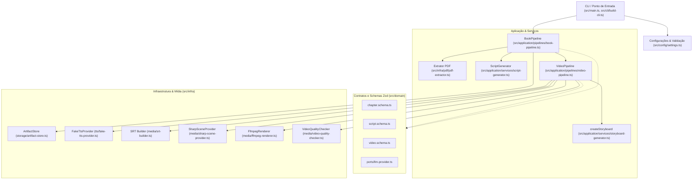

# DocToCine (lcBooks Pipeline)

Pipeline em **TypeScript / Node.js 24 LTS** para conversão automatizada de documentos e livros em formato PDF em múltiplos formatos de roteiros e vídeos cinematográficos (MP4), com síntese de áudio, legendagem sincronizada (SRT), cartelas gráficas visuais e controle rigoroso de qualidade.

O projeto adota princípios de **Clean Architecture** e **Arquitetura Hexagonal (Ports & Adapters)**, desacoplando completamente as regras de domínio e os fluxos da aplicação dos adaptadores de infraestrutura (leitura de PDF, renderização gráfica, FFmpeg, TTS e persistência de arquivos).

---

## Sumário

- [Visão Geral da Arquitetura](#visão-geral-da-arquitetura)
- [Estrutura do Repositório](#estrutura-do-repositório)
- [Detalhamento Aprofundado de Cada Código](#detalhamento-aprofundado-de-cada-código)
  - [1. Ponto de Entrada e Interface de Linha de Comando (CLI)](#1-ponto-de-entrada-e-interface-de-linha-de-comando-cli)
  - [2. Configuração e Núcleo (Core)](#2-configuração-e-núcleo-core)
  - [3. Camada de Domínio (Domain)](#3-camada-de-domínio-domain)
  - [4. Camada de Aplicação (Application & Pipelines)](#4-camada-de-aplicação-application--pipelines)
  - [5. Camada de Infraestrutura (Infrastructure & Adapters)](#5-camada-de-infraestrutura-infrastructure--adapters)
  - [6. Testes Unitários](#6-testes-unitários)
  - [7. Arquivos de Configuração do Ecossistema](#7-arquivos-de-configuração-do-ecossistema)
- [Fluxo de Execução do Pipeline Ponta a Ponta](#fluxo-de-execução-do-pipeline-ponta-a-ponta)
- [Estrutura de Artefatos Gerados](#estrutura-de-artefatos-gerados)
- [Instalação, Configuração e Execução](#instalação-configuração-e-execução)
- [Práticas de Confiabilidade e Segurança](#práticas-de-confiabilidade-e-segurança)

---

## Visão Geral da Arquitetura

O sistema organiza-se em camadas estritamente tipadas e com contratos explícitos validados em tempo de execução através do **Zod**:



---

## Estrutura do Repositório

Após a reorganização e remoção da pasta intermediária `typescript/`, todos os arquivos e comandos passam a operar a partir da raiz do repositório:

```text
DocToCine/
├── .github/
│   └── workflows/
│       └── ci.yml                # Pipeline de Integração Contínua (GitHub Actions)
├── src/
│   ├── main.ts                   # Ponto de entrada executável da CLI lcbooks
│   ├── cli/
│   │   └── build-cli.ts          # Definição de argumentos e opções com Commander
│   ├── config/
│   │   └── settings.ts           # Validação de variáveis de ambiente com Zod
│   ├── core/
│   │   ├── errors/
│   │   │   └── app-error.ts      # Hierarquia e taxonomia padronizada de erros
│   │   └── logging/
│   │       └── redact.ts         # Sanitização de tokens e segredos em logs/mensagens
│   ├── domain/
│   │   ├── ports/
│   │   │   └── llm-provider.ts   # Interface de abstração (port) para provedores de LLM
│   │   └── schemas/
│   │       ├── chapter.schema.ts # Schemas de capítulos, limites, teses e evidências
│   │       ├── script.schema.ts  # Schemas de roteiros, durações (1, 3, 20m) e segmentos
│   │       └── video.schema.ts   # Máquina de estados, storyboard e relatórios de qualidade
│   ├── application/
│   │   ├── services/
│   │   │   ├── chapter-detector.ts      # Detecção e validação de limites de capítulos
│   │   │   ├── script-generator.ts      # Geração de roteiros (estruturado LLM ou determinístico)
│   │   │   └── storyboard-generator.ts  # Criação de cenas e estimativa de tempo
│   │   └── pipelines/
│   │       ├── book-pipeline.ts  # Orquestração ponta a ponta do processamento do livro
│   │       └── video-pipeline.ts # Pipeline de renderização de vídeo e assets multimídia
│   └── infra/
│       ├── pdf/
│       │   └── pdf-extractor.ts         # Extração segura e validação de texto de PDF
│       ├── storage/
│       │   └── artifact-store.ts        # Operações atômicas de I/O em disco e persistência
│       ├── tts/
│       │   └── fake-tts-provider.ts     # Síntese determinística de áudio WAV (zero-cost)
│       └── media/
│           ├── srt-builder.ts           # Geração e parsing de legendas SRT sincronizadas
│           ├── sharp-scene-provider.ts  # Geração de imagens das cenas com gradientes via Sharp
│           ├── ffmpeg-renderer.ts       # Renderização de vídeo com FFmpeg (processo seguro)
│           └── video-quality-checker.ts # Verificação de conformidade técnica via ffprobe
├── tests/
│   └── unit/
│       └── domain.test.ts        # Suíte de testes unitários com Vitest
├── .env.example                  # Modelo de variáveis de ambiente
├── .gitignore                    # Regras de exclusão do Git
├── .prettierignore               # Exclusões para o formatador Prettier
├── .prettierrc.json              # Configurações do Prettier
├── eslint.config.js              # Configuração do ESLint 9 (Flat Config) com TypeScript
├── package.json                  # Dependências, scripts e metadados do pacote
├── package-lock.json             # Árvore exata de dependências
├── tsconfig.json                 # Configuração principal do compilador TypeScript
├── tsconfig.build.json           # Configuração de compilação para distribuição (dist/)
├── vitest.config.ts              # Configuração do executor de testes Vitest
└── README.md                     # Esta documentação completa e aprofundada
```

---

## Detalhamento Aprofundado de Cada Código

Abaixo está a análise minuciosa de cada arquivo do projeto, explicando sua finalidade, dependências, funções exportadas e detalhes de implementação.

---

### 1. Ponto de Entrada e Interface de Linha de Comando (CLI)

#### [`src/main.ts`](file:///Users/rafaelaparecido/Documents/DocToCine/src/main.ts)

- **Papel:** Ponto de entrada da CLI (`#!/usr/bin/env node`).
- **Principais responsabilidades:**
  - Instancia e processa os argumentos de linha de comando através de `buildCli()`.
  - Normaliza os parâmetros fornecidos pelo usuário: caminho do PDF de entrada, diretório de saída (resolvido de forma absoluta com `path.resolve`), lista de durações (validando estritamente os valores `1`, `3` ou `20` minutos) e número esperado de capítulos.
  - Instancia o `ArtifactStore` para gerenciar a persistência em disco.
  - Dispara a execução do `BookPipeline` e aguarda sua conclusão.
  - Emite no `stdout` um relatório resumido em JSON com os caminhos, capítulos gerados, quantidade de vídeos e lista de falhas.
  - Retorna códigos de saída semânticos do processo:
    - `0`: Sucesso total (todos os artefatos foram gerados com êxito).
    - `1`: Erro fatal de execução/configuração (capturado pelo bloco `catch`).
    - `2`: Conclusão parcial com artefatos pendentes ou com falha.
  - Possui o gatilho `if (import.meta.url === file://${process.argv[1]}) run()` que permite ser executado diretamente ou importado como módulo em testes.

#### [`src/cli/build-cli.ts`](file:///Users/rafaelaparecido/Documents/DocToCine/src/cli/build-cli.ts)

- **Papel:** Configuração declarativa da interface CLI via `commander`.
- **Principais responsabilidades:**
  - Define o nome do binário (`lcbooks`) e sua descrição operacional.
  - Configura o argumento obrigatório `<pdf>` representando o arquivo fonte.
  - Configura as opções (flags):
    - `-o, --output <dir>`: Diretório de destino dos artefatos (padrão: `saida`).
    - `-c, --chapters <n>`: Quantidade esperada de capítulos (padrão: `1`).
    - `-d, --durations <list>`: Lista delimitada por vírgulas com as durações desejadas (`1,3,20`).
    - `--render-videos`: Flag booleana indicando se os vídeos MP4 devem ser renderizados via FFmpeg ou se o pipeline deve parar na geração de roteiros e metadados.
    - `--resume`: Permite retomar execuções reaproveitando artefatos válidos já persistidos.
    - `--force`: Força a regeneração de todos os artefatos ignorando caches prévios.
    - `--continue-on-error`: Continua o processamento dos próximos capítulos mesmo se um falhar.
    - `--aspect-ratio <ratio>`: Seleciona o formato de vídeo (`16:9` widescreen ou `9:16` vertical/reels/shorts).
    - `-v, --verbose`: Ativa registros detalhados de execução.

---

### 2. Configuração e Núcleo (Core)

#### [`src/config/settings.ts`](file:///Users/rafaelaparecido/Documents/DocToCine/src/config/settings.ts)

- **Papel:** Carregamento centralizado e validação estrita de configurações do sistema.
- **Principais responsabilidades:**
  - Carrega automaticamente o arquivo `.env` via `dotenv/config`.
  - Constrói o `EnvSchema` via Zod com validações e valores padrão seguros:
    - `GEMINI_API_KEY` / `GOOGLE_API_KEY`: Chaves de autenticação com tratamento para strings vazias via preprocessador (`optionalSecret`).
    - `GEMINI_MODEL`: Modelo da LLM a ser utilizado (padrão: `gemini-2.5-flash`).
    - `TTS_PROVIDER`: Provedor de síntese de voz (`google_cloud` ou `fake`, padrão `fake`).
    - `TTS_LANGUAGE` / `TTS_VOICE` / `TTS_SPEAKING_RATE`: Configurações de áudio pt-BR.
    - `VIDEO_WIDTH` / `VIDEO_HEIGHT`: Resolução do vídeo (padrão: `1920x1080`).
    - `VIDEO_FPS`: Taxa de quadros (padrão: `30`).
    - `VIDEO_CRF`: Fator de taxa constante para o codec H.264 (padrão: `20`).
    - `VIDEO_PRESET`: Preset de velocidade/compressão do x264 (padrão: `medium`).
    - `BURN_CAPTIONS`: Booleano para gravação de legendas diretamente no vídeo.
    - `MAX_PDF_MB` / `MAX_PDF_PAGES`: Limites de segurança para evitar estouro de memória em PDFs massivos (padrão: `100MB` e `1000` páginas).
    - `MAX_CHAPTER_CHARS_PER_CHUNK`: Tamanho máximo do chunk de texto por capítulo (padrão: `12.000` caracteres).
    - `MAX_RETRY_ATTEMPTS`: Tentativas máximas de reexecução em falhas recuperáveis (padrão: `3`).
  - Funções utilitárias:
    - `loadSettings(env)`: Valida e retorna as configurações tipadas, lançando erro detalhado em caso de divergência.
    - `requireGemini(settings)`: Garante que uma chave de API válida esteja presente quando requisições reais forem feitas à API do Gemini.
    - `publicSettings(settings)`: Retorna uma cópia do objeto de configurações removendo chaves sensíveis para exibição segura em logs e relatórios.

#### [`src/core/errors/app-error.ts`](file:///Users/rafaelaparecido/Documents/DocToCine/src/core/errors/app-error.ts)

- **Papel:** Taxonomia unificada e tratamento de exceções da aplicação.
- **Principais responsabilidades:**
  - Define o tipo `ErrorStage`: identifica em qual etapa exata do fluxo o erro se originou (`configuration`, `pdf_extraction`, `chapter_detection`, `llm`, `summary`, `script_generation`, `storyboard`, `assets`, `audio`, `captions`, `rendering`, `quality_check`, `storage`, `general`).
  - Define o tipo `ErrorCode`: códigos de erro formais (`INVALID_INPUT`, `PDF_TOO_LARGE`, `PDF_INVALID`, `PDF_PAGE_LIMIT`, `EMPTY_EXTRACTION`, `LLM_AUTH`, `LLM_INVALID_OUTPUT`, `TTS_FAILED`, `FFMPEG_MISSING`, `PROCESS_TIMEOUT`, `ARTIFACT_INVALID`, `VIDEO_QUALITY_FAILED`, `UNEXPECTED`).
  - Implementa a classe `AppError extends Error`:
    - Armazena `code`, `stage`, a flag booleana `retryable` (indicando se a operação pode ser reexecutada com sucesso) e suporta a propriedade nativa `cause` do Node.js para encadeamento de stack traces originais.
  - Função utilitária `asError(v: unknown)`: Converte qualquer valor desconhecido (strings, objetos lançados) em uma instância garantida de `Error`.

#### [`src/core/logging/redact.ts`](file:///Users/rafaelaparecido/Documents/DocToCine/src/core/logging/redact.ts)

- **Papel:** Sanitização de dados sensíveis e segurança contra vazamento de credenciais em logs e consoles.
- **Principais responsabilidades:**
  - Define expressões regulares para identificar padrões comuns de tokens e credenciais:
    - Chaves do Google AI / GCP: `AIza[0-9A-Za-z\-_]{16,}`
    - Tokens de acesso OAuth2: `ya29\.[0-9A-Za-z\-_]+`
  - Função `sanitizeMessage(message, secrets, maxLength)`: Substitui tokens identificados por `[REDACTED_KEY]` e qualquer segredo específico passado por `[REDACTED]`, além de truncar mensagens que excedam o limite seguro (padrão: 2000 caracteres).
  - Função `safeJson(value, secrets)`: Serializa com segurança qualquer objeto JSON aplicando a sanitização sobre a string resultante.

---

### 3. Camada de Domínio (Domain)

#### [`src/domain/ports/llm-provider.ts`](file:///Users/rafaelaparecido/Documents/DocToCine/src/domain/ports/llm-provider.ts)

- **Papel:** Porta (interface) hexagonal para integração com modelos de linguagem.
- **Principais responsabilidades:**
  - Define o contrato da interface `LlmProvider`:
    ```typescript
    export interface LlmProvider {
      generateStructured<T>(prompt: string, schema: { parse(value: unknown): T }): Promise<T>;
    }
    ```
  - Permite que qualquer provedor de IA (Google Gemini via `@google/genai`, OpenAI, Claude ou provedores locais) seja acoplado sem alterar nenhuma linha de código da camada de aplicação.

#### [`src/domain/schemas/chapter.schema.ts`](file:///Users/rafaelaparecido/Documents/DocToCine/src/domain/schemas/chapter.schema.ts)

- **Papel:** Definição dos modelos de dados fundamentais sobre a estrutura do livro e capítulos.
- **Principais responsabilidades:**
  - `ChapterBoundarySchema`: Valida o número do capítulo, título, página inicial (`startPage`), página final (`endPage`) e evidências encontradas, garantindo via `.refine()` que `endPage >= startPage`.
  - `ChapterMapSchema`: Representa a lista de capítulos detectados com anotações e avisos do processo.
  - `SupportedClaimSchema`: Define uma afirmação/tese extraída com suas páginas de origem (`sourcePages`) e grau de confiança (`high`, `medium`, `low`).
  - `ChapterSummarySchema`: Estrutura do resumo do capítulo, contendo tese central, pontos-chave, exemplos, definições suportadas por fontes, takeaway para a audiência, motivos visuais e limitações.
  - `ChapterPackageSchema`: Pacote agregado que engloba metadados do capítulo, resumo, lista de roteiros gerados e ideias de imagens.
  - Função `normalizeChapterSummary(input)`: Normalizador defensivo que suporta formatos legados onde afirmações podiam ser strings ou objetos, mescla referências de páginas em um `Set` ordenado e garante que nenhuma citação perca a rastreabilidade com a página original do livro.

#### [`src/domain/schemas/script.schema.ts`](file:///Users/rafaelaparecido/Documents/DocToCine/src/domain/schemas/script.schema.ts)

- **Papel:** Modelagem de roteiros audiovisuais segmentados e durações permitidas.
- **Principais responsabilidades:**
  - `DurationSchema`: Enumeração estrita das durações cinematográficas suportadas: `1` minuto (Shorts/Reels/TikTok), `3` minutos (pitch/visão geral) e `20` minutos (estudo aprofundado).
  - `NarrationSegmentSchema`: Define uma unidade atômica de fala, contendo identificador sequencial (`id`), texto falado (`text`), sugestão de cena/b-roll (`sceneHint`), texto para sobreposição na tela (`onScreenText`) e páginas do livro que fundamentam o trecho (`sourcePages`).
  - `VideoScriptSchema`: Estrutura completa do roteiro com gancho inicial (`hook`), batidas de narrativa (`beats`), narração completa, segmentos e chamada para ação (`cta`).
  - Função `ensureScriptSegments(script, pages)`: Assegura que todo roteiro possua segmentos estruturados. Caso o modelo tenha retornado apenas texto contínuo, a função divide o conteúdo por quebras de parágrafo, distribui os tópicos das batidas como legendas de tela e atrela os identificadores `seg_0001`, `seg_0002`, etc.

#### [`src/domain/schemas/video.schema.ts`](file:///Users/rafaelaparecido/Documents/DocToCine/src/domain/schemas/video.schema.ts)

- **Papel:** Máquina de estados finitos do vídeo, storyboard e relatório de inspeção técnica.
- **Principais responsabilidades:**
  - `VideoStatusSchema`: Ciclo de vida determinístico do vídeo:
    `pending` ➔ `script_ready` ➔ `storyboard_ready` ➔ `assets_ready` ➔ `audio_ready` ➔ `captions_ready` ➔ `rendering` ➔ `rendered` ➔ `quality_checked` ➔ `completed` (com transição para `failed` permitida a partir de qualquer etapa).
  - `StoryboardSceneSchema`: Especificação de cada cena visual, relacionando IDs de segmentos narrativos, prompt visual gerador da imagem, texto na tela e duração calculada em segundos.
  - `QualityReportSchema`: Métricas de inspeção do vídeo final (codecs de vídeo e áudio, dimensões, fps, duração, presença de áudio, conformidade de legendas e lista de advertências/erros).
  - `VideoManifestSchema`: Registro de estado de cada vídeo, armazenando caminhos relativos de todos os seus artefatos (`storyboardPath`, `narrationPath`, `captionsPath`, `videoPath`, `qualityReportPath`), contagem de tentativas e status.
  - Funções `canTransition(from, to)` e `transition(manifest, to)`: Garantem que nenhuma etapa seja pulada indevidamente e registram o avanço do pipeline.

---

### 4. Camada de Aplicação (Application & Pipelines)

#### [`src/application/services/chapter-detector.ts`](file:///Users/rafaelaparecido/Documents/DocToCine/src/application/services/chapter-detector.ts)

- **Papel:** Algoritmos heurísticos de identificação e validação de capítulos a partir de páginas de texto.
- **Principais responsabilidades:**
  - `likelyChapterPages(pages)`: Aplica expressão regular sensível a variações linguísticas (`/^\s*(cap[ií]tulo|chapter)\b/im`) no início das páginas para detectar prováveis inícios de capítulos.
  - `validateBoundaries(chapters, total, strict)`: Valida se os limites dos capítulos estão dentro da quantidade total de páginas do livro e detecta colisões ou sobreposições entre capítulos consecutivos.
  - `normalizeBoundaries(map, total, expected)`: Ordena os capítulos por página inicial, corrige sobreposições ajustando a página final do capítulo anterior para ser imediatamente anterior à página inicial do seguinte (`c.endPage = next.startPage - 1`) e gera avisos caso a quantidade encontrada divirja da informada pelo usuário.
  - `parseChapterMap(value)`: Valida os limites com o schema de domínio.

#### [`src/application/services/script-generator.ts`](file:///Users/rafaelaparecido/Documents/DocToCine/src/application/services/script-generator.ts)

- **Papel:** Geração de roteiros adaptados para diferentes durações de vídeo.
- **Principais responsabilidades:**
  - Classe `ScriptGenerator`:
    - Recebe opcionalmente uma instância de `LlmProvider`.
    - No método `generate(summary, chapter, duration)`:
      - Se a LLM estiver configurada, dispara o prompt solicitando a geração estruturada segundo o `VideoScriptSchema`.
      - Se a LLM não estiver presente (execução offline ou modo fallback), constrói um roteiro determinístico completo compilando a tese, os pontos-chave e as conclusões extraídas no resumo do capítulo, vinculando todas as páginas originais de referência.

#### [`src/application/services/storyboard-generator.ts`](file:///Users/rafaelaparecido/Documents/DocToCine/src/application/services/storyboard-generator.ts)

- **Papel:** Transformação do roteiro narrativo em uma sequência cronológica de cenas visuais.
- **Principais responsabilidades:**
  - Função `createStoryboard(script, chapter)`:
    - Itera sobre cada segmento do roteiro e gera uma cena (`scene_001`, `scene_002`...).
    - Calcula dinamicamente a duração em segundos de cada cena baseando-se na densidade de palavras do texto da narração (taxa de conversão: ~2.3 palavras por segundo, com piso mínimo de 1 segundo).
    - Preserva os prompts visuais e associa as páginas de referência do capítulo.

#### [`src/application/pipelines/book-pipeline.ts`](file:///Users/rafaelaparecido/Documents/DocToCine/src/application/pipelines/book-pipeline.ts)

- **Papel:** Orquestrador mestre do livro em alto nível.
- **Principais responsabilidades:**
  - Executa a extração inicial do arquivo PDF fornecido com limites de tamanho e páginas via `extractPdf`.
  - Constrói a partição de capítulos (calculando intervalos de páginas correspondentes à quantidade esperada).
  - Para cada capítulo:
    - Normaliza o resumo do capítulo e agrega as páginas de fundamentação.
    - Para cada duração solicitada (`1`, `3`, `20` minutos):
      - Aciona o `ScriptGenerator` para criar o roteiro correspondente.
      - Se a flag `renderVideos` estiver ativa, delega a renderização para o `VideoPipeline`.
      - Registra eventuais falhas sem abortar os demais capítulos quando aplicável.
  - Persiste de maneira atômica e padronizada os seguintes artefatos na raiz do diretório de saída:
    - `book.json`: Dados gerais do livro e quantidade de capítulos processados.
    - `mapa_capitulos.json`: Mapa completo de limites de páginas de cada capítulo.
    - `capitulo_XX.json`: Pacote individual com resumos, roteiros e ideias de cada capítulo.
    - `manifest.json`: Manifesto de execução geral com status (`completed` ou `partial`).
    - `resultado_completo.json`: Consolidação de todos os pacotes de capítulos.
    - `roteiros_e_ideias.md`: Documento Markdown consolidando os títulos e teses dos roteiros.
    - `run_report.json`: Relatório técnico final contendo falhas registradas e métricas.

#### [`src/application/pipelines/video-pipeline.ts`](file:///Users/rafaelaparecido/Documents/DocToCine/src/application/pipelines/video-pipeline.ts)

- **Papel:** Orquestrador da renderização multimídia de cada vídeo individual.
- **Principais responsabilidades:**
  - Cria a estrutura de pastas do vídeo: `chapter_XX/video_XXmin/` contendo os subdiretórios `scenes/` e `audio/`.
  - Aciona o `createStoryboard` para converter o roteiro em cenas.
  - Dispara o `SharpSceneProvider` para criar as imagens gráficas de cada cena em `scenes/scene_XXX.png`.
  - Dispara o sintetizador de voz (TTS) para gerar os arquivos de áudio por segmento e calcular os tempos exatos de início e fim (`timed segments`).
  - Consolida o áudio mestre da narração (`narration.mp3`).
  - Aciona o `buildSrt` para gerar o arquivo de legendas sincronizadas `captions.srt`.
  - Aciona o `FfmpegRenderer` passando as imagens das cenas, suas durações e o áudio da narração para produzir o arquivo final `video.mp4`.
  - Executa o `checkVideo` para auditar a conformidade técnica do MP4 gerado via `ffprobe`.
  - Persiste o `quality_report.json` e o `manifest.json` com os caminhos relativos ao diretório base de saída.

---

### 5. Camada de Infraestrutura (Infrastructure & Adapters)

#### [`src/infra/pdf/pdf-extractor.ts`](file:///Users/rafaelaparecido/Documents/DocToCine/src/infra/pdf/pdf-extractor.ts)

- **Papel:** Leitura, higienização e extração de texto de arquivos PDF sem depender de binários nativos pesados ou processos externos.
- **Principais responsabilidades:**
  - `cleanText(text)`: Limpa caracteres nulos (`\x00`), normaliza espaços consecutivos e remove quebras de linha excessivas.
  - `extractPdf(path, options)`:
    - Verifica a existência do arquivo e seu tamanho máximo (`maxBytes`).
    - Valida o cabeçalho do arquivo verificando a assinatura mágica `%PDF-`.
    - Realiza a divisão das páginas procurando delimitadores de form feed (`\f`) e marcadores de estrutura interna `/Type /Page`.
    - Valida se o documento excede o limite de páginas configurado.
    - Emite `AppError` com códigos específicos (`PDF_TOO_LARGE`, `PDF_INVALID`, `PDF_PAGE_LIMIT`, `EMPTY_EXTRACTION`) permitindo tratamento semântico de erros.
  - `getRange(pages, start, end)`: Extrai e rotula de forma contígua o texto pertencente a uma faixa de páginas com indicação explícita `[Página X]`.

#### [`src/infra/storage/artifact-store.ts`](file:///Users/rafaelaparecido/Documents/DocToCine/src/infra/storage/artifact-store.ts)

- **Papel:** Gerenciamento seguro de I/O de arquivos, diretórios e persistência atômica.
- **Principais responsabilidades:**
  - `stableHash(value)`: Gera hashes SHA-256 consistentes e ordenados por chave a partir de qualquer objeto para identificação de mudanças em roteiros e configurações.
  - `atomicJson(path, value)`: Grava arquivos primeiro em uma extensão temporária (`.tmp`) e depois realiza um `rename` atômico do sistema operacional. Isso previne corrupção de arquivos caso o processo seja interrompido no meio da escrita.
  - Classe `ArtifactStore`:
    - Normaliza caminhos relativos sempre com barras normais (`/`), garantindo portabilidade entre Windows, Linux e macOS.
    - Implementa helpers semânticos de caminhos: `chapterDir(n)` (`chapter_01`), `videoDir(n, d)` (`chapter_01/video_03min`).
    - Valida segurança contra ataques de _path traversal_ garantindo que nenhum arquivo seja gravado fora do diretório base.
    - Métodos especializados para carregar e salvar manifestos e roteiros validados com Zod.

#### [`src/infra/tts/fake-tts-provider.ts`](file:///Users/rafaelaparecido/Documents/DocToCine/src/infra/tts/fake-tts-provider.ts)

- **Papel:** Provedor determinístico de síntese de voz (TTS) para desenvolvimento, testes e execução sem custo de API externa.
- **Principais responsabilidades:**
  - Sintetiza arquivos de áudio WAV válidos com cabeçalho canônico RIFF de 44 bytes em memória (`Buffer`), taxa de amostragem de 8 kHz e 16 bits mono.
  - Calcula a duração exata do áudio com base na contagem de palavras do texto (padrão: 0.12 segundos por palavra).
  - Em `synthesizeSegments`, calcula um cursor temporal cumulativo (`startSeconds`, `endSeconds`) gerando metadados de sincronização temporal precisos para a construção das legendas.

#### [`src/infra/media/srt-builder.ts`](file:///Users/rafaelaparecido/Documents/DocToCine/src/infra/media/srt-builder.ts)

- **Papel:** Construção e análise de legendas no formato padrão SubRip (`.srt`).
- **Principais responsabilidades:**
  - `time(seconds)`: Formata segundos decimais na representação cronológica do SRT (`HH:MM:SS,mmm`).
  - `chunks(text)`: Fragmenta o texto falado em blocos confortáveis para leitura na tela (máximo de 8 palavras ou 55 caracteres por linha).
  - `buildSrt(segments, path)`: Distribui as falas proporcionalmente no intervalo de tempo de cada segmento, gerando números de sequência contínuos e escrevendo o arquivo de forma atômica (`.tmp` seguido de `rename`).
  - `parseSrtCues(path)`: Lê um arquivo `.srt` e converte as marcações em tuplas tipadas contendo número, tempo inicial em segundos, tempo final em segundos e texto, viabilizando verificações automatizadas de integridade.

#### [`src/infra/media/sharp-scene-provider.ts`](file:///Users/rafaelaparecido/Documents/DocToCine/src/infra/media/sharp-scene-provider.ts)

- **Papel:** Geração de cartelas visuais e backgrounds das cenas via processamento de imagem com a biblioteca `sharp`.
- **Principais responsabilidades:**
  - Recebe as dimensões do vídeo configuradas (padrão: 1920x1080).
  - Constrói programaticamente um modelo vetorial SVG com gradiente moderno (tons escuros `#111827` para violeta `#7c3aed`), fundo escuro e tipografia com escape correto de caracteres XML (`&amp;`, `&lt;`, etc.).
  - Converte o SVG para PNG de alta qualidade gravando no caminho de saída correspondente à cena (`scenes/scene_XXX.png`).

#### [`src/infra/media/ffmpeg-renderer.ts`](file:///Users/rafaelaparecido/Documents/DocToCine/src/infra/media/ffmpeg-renderer.ts)

- **Papel:** Motor de montagem e renderização audiovisual via FFmpeg.
- **Principais responsabilidades:**
  - Executa o comando binário `ffmpeg` com `shell: false` via `child_process.spawn`, prevenindo vulnerabilidades de injeção de comandos.
  - Cria um arquivo de instruções de concatenação (`.concat.txt`) especificando cada imagem e seu tempo exato de exibição.
  - Executa a codificação do vídeo em arquivo temporário (`.partial.mp4`):
    - Demuxer `concat` com `-safe 0`.
    - Vinculação com o arquivo de áudio mestre (`-i audioPath`).
    - Parâmetro `-shortest` para evitar caudas de vídeo desincronizadas com o áudio.
    - Filtro de redimensionamento e espaço de cor padronizado: `scale=W:H,format=yuv420p` (compatibilidade universal em navegadores, QuickTime e dispositivos móveis).
    - Codec de vídeo: `libx264` com controle de `preset` e taxa constante de quantização `crf`.
    - Codec de áudio: `aac` a 128 kbps.
  - Ao finalizar a renderização com código de sucesso 0, renomeia atomicamente o arquivo `.partial.mp4` para o destino final `video.mp4` e limpa os arquivos temporários no bloco `finally`.

#### [`src/infra/media/video-quality-checker.ts`](file:///Users/rafaelaparecido/Documents/DocToCine/src/infra/media/video-quality-checker.ts)

- **Papel:** Auditoria e controle de qualidade automatizado (Quality Gate) dos vídeos gerados.
- **Principais responsabilidades:**
  - `probe(path)`: Invoca o `ffprobe` com saída em JSON (`-print_format json -show_streams -show_format`) com `shell: false`.
  - `checkVideo(path, expected)`:
    - Verifica se o arquivo existe e possui tamanho superior a 100 bytes (eliminando saídas vazias ou corrompidas).
    - Analisa a existência do stream de vídeo e do stream de áudio.
    - Confere se as dimensões reais de largura e altura coincidem com a resolução esperada.
    - Extrai a duração total reportada no container.
    - Preenche o `QualityReportSchema` indicando se o arquivo foi aprovado (`passed: true`) ou reprovado (`passed: false`), listando detalhadamente cada não conformidade identificada.

---

### 6. Testes Unitários

#### [`tests/unit/domain.test.ts`](file:///Users/rafaelaparecido/Documents/DocToCine/tests/unit/domain.test.ts)

- **Papel:** Suíte de verificação de invariantes de domínio e contratos com `vitest`.
- **Casos de teste cobertos:**
  1. _Validações de duração e segmentação legada:_ Garante que durações inválidas (ex: 5 minutos) disparem erro do Zod e confirma que textos de narração contínuos com quebras duplas de linha sejam devidamente fatiados em `seg_0001`, `seg_0002` com as páginas herdadas.
  2. _Normalização de resumos e retenção de páginas:_ Verifica se a função `normalizeChapterSummary` preserva alegações estruturadas legadas e constrói o array `sourcePages` contendo as páginas corretas.
  3. _Sanitização de credenciais e máquina de estados:_ Confirma que tokens com prefixo `AIza...` e palavras-chave customizadas são devidamente ocultadas da mensagem, e valida transições permitidas (`pending -> script_ready`) e proibidas (`completed -> rendering`).

---

### 7. Arquivos de Configuração do Ecossistema

- [`package.json`](file:///Users/rafaelaparecido/Documents/DocToCine/package.json):
  - Declara `"type": "module"` para ESM nativo.
  - Restringe o runtime em `"engines"` para `node: ">=24 <25"`.
  - Configura o binário `"bin": { "lcbooks": "dist/main.js" }`.
  - Define scripts de ciclo de vida:
    - `npm run dev`: Execução direta com compilação JIT via `tsx`.
    - `npm run build`: Compilação TypeScript de produção com `tsc -p tsconfig.build.json`.
    - `npm start`: Execução do binário compilado em `dist/main.js`.
    - `npm run typecheck`: Checagem rigorosa de tipos sem emissão de arquivos (`tsc --noEmit`).
    - `npm run lint`: Análise estática com ESLint em `src` e `tests`.
    - `npm run format:check` e `npm run format`: Checagem e formatação automática com Prettier.
    - `npm test`: Execução da suíte Vitest em modo headless.
    - `npm run check`: Pipeline local que executa formatação, lint, checagem de tipos e testes unitários em sequência.
- [`tsconfig.json`](file:///Users/rafaelaparecido/Documents/DocToCine/tsconfig.json):
  - Configurado com `target: "ES2022"`, `module: "NodeNext"`, `moduleResolution: "NodeNext"`, e flags rígidas: `strict`, `noImplicitAny`, `noUncheckedIndexedAccess`, `exactOptionalPropertyTypes`.
- [`tsconfig.build.json`](file:///Users/rafaelaparecido/Documents/DocToCine/tsconfig.build.json):
  - Estende o `tsconfig.json`, isolando o escopo de compilação estritamente para `src/**/*.ts` com saída em `dist/`.
- [`eslint.config.js`](file:///Users/rafaelaparecido/Documents/DocToCine/eslint.config.js):
  - Configuração moderna do ESLint 9 (Flat Config) utilizando `typescript-eslint`, banindo o uso de `any` explícito (`@typescript-eslint/no-explicit-any: error`).
- [`vitest.config.ts`](file:///Users/rafaelaparecido/Documents/DocToCine/vitest.config.ts):
  - Configura o Vitest para detectar arquivos de teste em `tests/**/*.test.ts` e suporte a relatórios de cobertura V8.
- [`.github/workflows/ci.yml`](file:///Users/rafaelaparecido/Documents/DocToCine/.github/workflows/ci.yml):
  - Workflow automatizado de CI que é disparado a cada `push` e `pull_request` no repositório. Prepara o Node.js 24, instala dependências via `npm ci` utilizando cache do `package-lock.json`, executa o `npm run check` e realiza o build com `npm run build`.
- [`.prettierrc.json`](file:///Users/rafaelaparecido/Documents/DocToCine/.prettierrc.json) e [`.prettierignore`](file:///Users/rafaelaparecido/Documents/DocToCine/.prettierignore):
  - Regras de formatação de código e exclusão de diretórios como `dist`, `coverage`, `node_modules` e pastas de artefatos de saída `saida*`.
- [`.gitignore`](file:///Users/rafaelaparecido/Documents/DocToCine/.gitignore):
  - Ignora pastas de compilação, dependências, arquivos de variáveis de ambiente (`.env`), arquivos de sistema (`.DS_Store`) e saídas do pipeline.

---

## Fluxo de Execução do Pipeline Ponta a Ponta

Quando o comando `lcbooks` é disparado, o ciclo de vida completo ocorre nas seguintes etapas:

```text
[1. Entrada]
   └── PDF fornecido é validado (tamanho, assinatura %PDF-, páginas)

[2. Análise Estrutural]
   └── Texto é extraído e dividido em capítulos ordenados (ChapterBoundary)

[3. Síntese e Roteirização]
   ├── Extração da tese central, pontos-chave e conceitos do capítulo
   └── Para cada duração (1 min, 3 min, 20 min):
         └── Geração do roteiro adaptado com beats narrativos e identificadores de segmento

[4. Produção de Mídia (se --render-videos for ativo)]
   ├── Storyboard: Cálculo do tempo de exibição e divisão em cenas visuais
   ├── Cartelas Visuais: Criação dos assets gráficos em PNG com gradiente SVG via Sharp
   ├── Síntese de Voz: Geração de áudio WAV/MP3 com timestamps de cada fala
   ├── Legendas: Criação do arquivo captions.srt formatado e sincronizado
   ├── Renderização: Junção de cenas + áudio com codificação H.264/AAC via FFmpeg
   └── Quality Gate: Inspeção técnica via ffprobe para validar resolução, fps, codecs e áudio

[5. Persistência e Manifesto]
   └── Escrita atômica de todos os JSONs, relatórios e do manifesto geral em disco
```

---

## Estrutura de Artefatos Gerados

Ao processar um livro com `--output saida --chapters 3 --durations 1,3,20 --render-videos`, o diretório de destino é estruturado da seguinte forma:

```text
saida/
├── book.json                    # Metadados da fonte e quantidade de capítulos
├── mapa_capitulos.json          # Mapeamento com intervalos de páginas e evidências
├── capitulo_01.json             # Resumo analítico, tese e roteiros do capítulo 1
├── capitulo_02.json             # Resumo analítico, tese e roteiros do capítulo 2
├── capitulo_03.json             # Resumo analítico, tese e roteiros do capítulo 3
├── roteiros_e_ideias.md         # Documento em Markdown consolidando roteiros
├── resultado_completo.json      # Consolidação de todos os pacotes em um único JSON
├── run_report.json              # Relatório de status e lista de artefatos pendentes
├── manifest.json                # Manifesto mestre de status da execução
│
├── chapter_01/
│   ├── video_01min/
│   │   ├── scenes/
│   │   │   ├── scene_001.png    # Cartela gráfica da cena 1
│   │   │   └── scene_002.png    # Cartela gráfica da cena 2
│   │   ├── audio/
│   │   │   ├── seg_0001.mp3     # Áudio sintetizado do segmento 1
│   │   │   └── narration.mp3    # Áudio contínuo consolidado
│   │   ├── captions.srt         # Legendas no padrão SRT
│   │   ├── video.mp4            # Vídeo final renderizado em H.264/AAC
│   │   ├── quality_report.json  # Relatório de aprovação técnica do vídeo
│   │   └── manifest.json        # Manifesto com caminhos relativos e status do vídeo
│   ├── video_03min/
│   └── video_20min/
├── chapter_02/
└── chapter_03/
```

---

## Instalação, Configuração e Execução

### Pré-requisitos do Sistema

1. **Node.js**: Versão 24 LTS (`>=24 <25`).
2. **FFmpeg & FFprobe**: Necessários para renderização de vídeos e verificação de conformidade técnica.
   - No macOS: `brew install ffmpeg`
   - No Ubuntu/Debian: `sudo apt-get update && sudo apt-get install -y ffmpeg`

### Instalação

Na raiz do repositório, execute:

```bash
npm ci
```

### Configuração de Variáveis de Ambiente

Copie o arquivo de exemplo e ajuste suas configurações conforme necessário:

```bash
cp .env.example .env
```

Parâmetros principais no `.env`:

- `GEMINI_API_KEY`: Chave da API do Google Gemini (necessária apenas para geração de roteiros via IA real).
- `TTS_PROVIDER`: Defina como `fake` para testes locais e sem custo (padrão) ou `google_cloud` para síntese via Cloud Text-to-Speech.
- `VIDEO_WIDTH` / `VIDEO_HEIGHT`: Padrão `1920` e `1080` (16:9).

### Scripts de Qualidade e Compilação

```bash
# Executar a verificação completa (formatação, lint, types e testes unitários):
npm run check

# Compilar o código TypeScript para JavaScript (dist/):
npm run build

# Executar apenas a suíte de testes:
npm test

# Formatar o código-fonte automaticamente:
npm run format
```

### Execução da CLI

Após compilar o projeto (`npm run build`), você pode executar:

```bash
# Visualizar a ajuda e todas as opções:
node dist/main.js --help

# Processar um PDF gerando roteiros para 3 capítulos nas durações de 1, 3 e 20 minutos:
node dist/main.js livro.pdf --output saida --chapters 3 --durations 1,3,20

# Processar um PDF gerando roteiros e renderizando os vídeos MP4 completos:
node dist/main.js livro.pdf --output saida --chapters 3 --durations 1,3,20 --render-videos
```

Também é possível executar diretamente em desenvolvimento via `tsx`:

```bash
npm run dev -- livro.pdf --output saida --chapters 1 --durations 1
```

---

## Práticas de Confiabilidade e Segurança

1. **Escrita Atômica em Disco:** Todos os arquivos JSON, SRT e MP4 são escritos primeiramente com sufixo `.tmp` ou `.partial.mp4`. Apenas após a gravação completa e sem erros, o arquivo é renomeado atomicamente com `rename`. Isso impede arquivos corrompidos ou incompletos em caso de queda de energia ou cancelamento do processo.
2. **Execução Segura de Processos:** Chamadas a ferramentas externas (`ffmpeg`, `ffprobe`) utilizam `child_process.spawn` com `{ shell: false }`, eliminando qualquer risco de injeção de comandos de shell através de nomes de arquivos.
3. **Prevenção de Vazamento de Credenciais:** As mensagens e logs passam pelo módulo de sanitização (`src/core/logging/redact.ts`), que identifica e mascara automaticamente chaves de API (`AIza...`) e tokens de autorização.
4. **Validação em Tempo de Execução:** Toda entrada externa (arquivos PDF, variáveis de ambiente, retornos de IA) é validada por schemas Zod antes de ingressar no fluxo de negócio.
